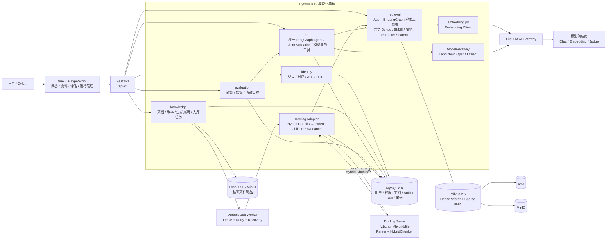
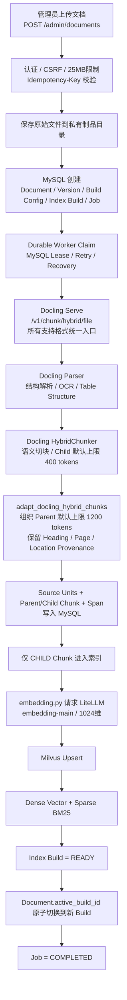
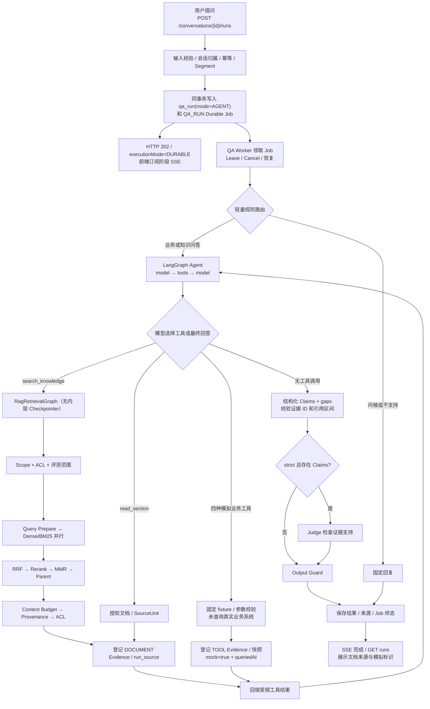

# 企业内部知识库项目

Python FastAPI 主业务、Milvus 向量与混合检索、LiteLLM AI Gateway（供应商 API 密钥由网关独立持有）、Docling 独立解析服务，面向运营、产品和技术共用的企业级内部知识库。前端简洁，重点是细粒度权限控制、文档全生命周期、混合检索策略、可追溯事实断言回答、自动化评测与故障恢复。旧 Java/Spring Boot/Elasticsearch 基线可通过 Git 历史标签或提交记录定位。

> **当前 main（2026-10-10）**：[PR #14](https://github.com/songsinfo/RAG/pull/14) 已合并（`2b40a9b`），统一 Agent、Durable QA 和跨轮版本化快照代码已进入主分支；**合并不等于 UA-01～UA-12 全量生产验收完成**。四个业务诊断工具仍为固定模拟结果，没有调用 Java 或真实业务系统；真实模型表现及缓存收益仍需实测。范围、剩余验收与回滚条件见[统一业务 Agent 实施状态](docs/delivery/unified-business-agent-implementation-status.md)。

## 系统架构与核心流程

> 以下图基于当前 Python 实现整理。当前后端采用 FastAPI + MySQL + Milvus + LiteLLM；Markdown、TXT、PDF、DOCX、Office 等所有支持格式统一通过 Docling Serve 的 `/v1/chunk/hybrid/file` 完成文档解析与 HybridChunker 语义切块，后端再将 Docling Hybrid Chunks 适配为 Parent-Child 结构并保留标题、页码、来源位置等 provenance 信息。后台 INGEST/PURGE/EVALUATE 和**所有新建在线问答**使用 MySQL 持久化 Job + Lease Worker；旧普通 RAG 的 REALTIME 路径只为历史未完成任务保留兼容代码。进度通过 SSE 事件通道推送，最终答案在验证完成后展示。

### 系统架构图

架构中的关键约束：**MySQL 是权限与生效 Build 的权威来源**，Milvus 只保存可重建的检索索引；每次检索先从 MySQL 计算当前用户可读的 `active_build_id`，再把这些 Build ID 作为 Milvus 过滤条件，从源头避免越权召回。模型供应商密钥由 LiteLLM 独立持有，业务后端只调用内部模型别名。

### 文档入库流程图

### 统一业务 Agent 问答流程图（当前 main）

**执行入口**：新请求不带 `mode`、带旧 `mode=RAG` 或 `mode=AGENT`，均规范化为 AGENT，创建 `qa_run + QA_RUN Job`，由 Worker 执行。原旧运行及历史指标**不更改语义**，旧 REALTIME 执行分支在排空/处理旧队列前仍保留。SSE 当前只推送运行阶段，并非模型逐 Token 输出。

**两层图职责**：外层 [`LangGraphAgent`](backend/app/qa/agent.py) 模型决定是否检索、调用哪个工具以及何时回答；`search_knowledge` 通过 [`RagRetrievalGraph`](backend/app/retrieval/rag_graph.py) 完成 ACL → Query Prepare → Dense/BM25 → RRF → Rerank/Context → Evidence，不负责生成答案。检索图没有持久化 Checkpointer，外层 Agent checkpoint 不能从内层任意检索节点恢复。独立 `/search` 和纯检索评测仍保留 `RetrievalPipeline.retrieve()`。

**两类证据**：文档引用由 `documentId/buildId`、来源原文和 ACL 约束；`TOOL` 引用存储 `sourceType/toolName/sourceSnapshot`、查询对象、`queriedAt`、`fixtureVersion`、`mock`，不伪造文档链接。页面及回答通过后端字段提示“模拟结果，未查询真实业务系统”。这不意味着真实用户业务资格经过核验。上下文压缩与缓存可观测性尚不等于跨轮稳定 KV cache 已验收；详细状态见实施记录。

## 当前实现与验收边界（PR #14 已合并；仍需逐项验收）

- **统一权限真源**：Search API、普通 RAG、Agent 检索统一使用 `get_readable_build_records()`，同时覆盖租户、用户状态、KB ACL、文档 ACL、用户组和 active build。
- **TOCTOU 防护**：检索后、模型外发前再次核对当前权限与 `active_build_id`；权限撤销或版本切换时返回 `SOURCE_CHANGED`，不把失效来源发送给模型。
- **完整 Evidence Provenance**：Milvus Hit 返回真实 `kbId/documentId/versionId/buildId/chunkId`，并关联 `source_unit/location`；不再用 `allowed_build_ids[0]` 猜测来源。
- **配置驱动 Retrieval**：Dense/Sparse 候选数、RRF、Reranker、Parent Expansion、Final Top-K 均由版本化 Retrieval Config 控制。
- **Reranker + Parent Expansion**：Child Chunk 用于高精度召回，Reranker 精排后可扩展到 Parent Context，兼顾召回精度和生成上下文完整性。
- **Agent 复用 LangGraph 检索图**：Dense/BM25 并行、RRF 汇合、Reranker / MMR / Parent / 上下文预算独立节点；每阶段 `run_event` 记录候选数量与耗时，**尚未**保存完整候选排名或计算阶段级 Recall@5 / NDCG@5。Agent 依旧使用独立的 model/tools 图。
- **统一 Docling + HybridChunker 入库**：Markdown、TXT、PDF、DOCX、Office 等所有支持格式统一调用 Docling `/v1/chunk/hybrid/file`；Docling 负责解析与 HybridChunker 子块切分，后端通过 `adapt_docling_hybrid_chunks()` 组织 Parent-Child 结构，并保留 Heading、Page、Doc Item、Location 等 provenance。默认 Child 上限为 400 tokens、Parent 上限为 1200 tokens，均可通过构建配置或环境变量调整。
- **统一 Agent 问答通道**：新提问总是创建 `QA_RUN` Durable Job，前端移除 RAG / Agent 模式选择，保留 SSE、取消、追问与受权限控制的历史展示；旧 REALTIME 代码用于历史兼容，尚未完成清理。
- **Durable Job Worker**：INGEST/PURGE/EVALUATE 和新建统一 Agent 问答使用 MySQL Job + Lease/Retry/Recovery；支持内嵌 Worker，也可执行 `python -m app.runtime.worker` 独立扩容。
- **对象存储**：Artifact Store 支持本地与 S3/MinIO，`RAG_ARTIFACT_STORE=s3` 即可切换。
- **Agent Runtime 原生化**：Agent 继续使用低层 `StateGraph` 保留 ACL / Evidence / Durable Job 等企业定制能力，但状态持久化与恢复切换到 LangGraph `Checkpointer + interrupt + Command(resume=...)`，上下文使用保守 Token 估算及高低水位完整对话组裁剪（未达到阈值保留前缀），不再采用 LangChain `trim_messages` 逐轮裁剪；跨 run 的授权历史与结构化业务状态已在 `context_segment` 中版本化持久化（普通追加保留快照版本、压缩时更新版本与边界）；不等于共享完整 LangGraph checkpoint，也不代表供应商 KV Cache 已验证。
- **跨轮持久化与恢复边界**：`qa/segment_context.py` 的快照保存已授权的 user/assistant 历史、业务对象和来源依赖；`JobCheckpointSaver` 仅在单次 `QA_RUN` 的 `job.checkpoint.langgraph` 中保存可恢复节点状态。历史证据 ID 不能直接跨 run 复用；已存在数据库需应用 `20261010_segment_context_snapshot.sql` 增量迁移。
- **职责边界**：LangGraph 负责图状态和 HITL 恢复，项目实现上下文预算和消息组裁剪；项目继续负责租户 ACL、Evidence Provenance、Durable Worker、运行预算、审计、评测和 Observability。
- **CI 基线**：GitHub Actions 执行 Python compile/pytest 与前端 type-check/test/build。

## 阅读顺序

若目标是理解当前 Python 项目并阅读主要源码，先看[源码导读：从上传文件到回答与评估](docs/source-walkthrough.md)，再看[Agent 知识检索工具图说明](docs/rag-langgraph-retrieval.md)和[RAG 评估完整说明](docs/rag-evaluation-guide.md)。下面的 PRD 与技术设计用于理解需求和设计意图，其中部分仍描述旧 Java / Elasticsearch 方案，当前行为以源码及这两份导读的核对基线为准。

1. [当前范围与交付顺序](docs/00-project-assessment.md)
2. [PRD-00 产品总览](docs/prd/PRD-00-product-overview.md)
3. [PRD-01 身份与文档权限](docs/prd/PRD-01-identity-and-access.md)
4. [PRD-02 文档解析与生命周期](docs/prd/PRD-02-document-lifecycle.md)
5. [PRD-03 检索、回答与证据](docs/prd/PRD-03-retrieval-answer-evidence.md)
6. [PRD-04 会话、取消与反馈](docs/prd/PRD-04-conversations-feedback.md)
7. [PRD-05 评估系统与策略实验](docs/prd/PRD-05-evaluation-experiments.md)
8. [PRD-06 运行管理与交付](docs/prd/PRD-06-operations-delivery.md)
9. [PRD-07 Agent 深入问答](docs/prd/PRD-07-agent-deep-qa.md)
10. [B0-B3 检索消融实验运行手册](docs/delivery/2026-09-13-retrieval-ablation-runbook.md)
11. [RAG 评估完整说明：方法、指标、执行流程与当前实现](docs/rag-evaluation-guide.md)
12. [Agent 检索工具：LangGraph 检索 DAG 与阶段事件](docs/rag-langgraph-retrieval.md)
13. [统一业务 Agent 规格](docs/design/10-unified-business-agent-spec.md)
14. [统一业务 Agent 任务与未完成验收](docs/delivery/unified-business-agent-tickets.md)
15. [PR #14 实施现状与数据库迁移](docs/delivery/unified-business-agent-implementation-status.md)
16. [Langfuse 接入技术规格（首期元数据观测；不引入 Ragas）](docs/design/11-langfuse-observability-spec.md)
17. [Langfuse 与后续自建评估增强 Tickets](docs/delivery/langfuse-observability-tickets.md)
18. [Langfuse 首期实施与私有合成验收](docs/delivery/langfuse-implementation-status-20261012.md)
19. [EOBS 评估增强、人工确认合成资料与真实模型联调](docs/delivery/evaluation-observability-implementation-20261012.md)
20. [Langfuse 可配置模型、检索、工具与问答输入输出](docs/delivery/langfuse-content-observability-20261012.md)

上述 PRD 按 to-spec 模板组织：问题、方案、用户故事、实现决定、测试决定、范围外事项及备注。它们综合已确认访谈，不代表已实现，也没有发布到外部 Issue Tracker。

## 当前确定的边界

- 内部系统、本地账号、固定维护管理员；文档级读权限由后端执行。
- 支持 Markdown/TXT、DOCX、PDF、FAQ、Wiki 导出文件及附件；扫描 OCR、图片描述和表格结构提取纳入范围。
- 全部约定策略均需实现并对照评测，不要求每次请求全部启用。
- 先使用模拟/确认脱敏资料；不自动导入或向在线模型发送公司正文。
- 先完成 PRD，再做技术设计，最后分阶段编码。代码全部由开发代理实现，并解释实际调用链和失败案例。

## 详细技术设计

从[技术设计入口](docs/design/README.md)开始，依次阅读架构、数据库与权限、入库状态机、检索与证据、API/会话/Agent、评估和实施验收。附件含 MySQL DDL 和 Milvus 集合映射；[验收追踪表](docs/design/08-traceability.md)逐条对应 81 项 PRD 验收。

当前代码已完成 Python/FastAPI + Milvus + Docling HybridChunker 主链路。真实 MySQL/Milvus/Docling/LiteLLM 联合验收与 B0-B3 模型消融仍应在独立 evaluation 环境执行；在生成并核对真实运行报告前，不应把静态追踪或测试通过表述成真实模型效果已经验证。

## 资料组织

当前已有 README、范围文档、PRD、技术设计、后端、前端、部署脚本和评测框架：

- docs/design：详细技术设计。
- docs/decisions：取舍与技术决策。
- docs/learning/sources、concepts、practice：来源笔记、概念笔记、实际问题与验证。
- docs/delivery：部署、验收、演示和真实项目成果。
- backend、frontend：Python FastAPI 后端和功能页面。
- datasets、experiments：授权样本、题集、策略配置和脱敏报告。
- deploy：部署与初始化资料。

原始公司文件、上传数据、运行数据库、敏感日志和密钥不提交版本库。所有资料均遵循租户及文档权限。
