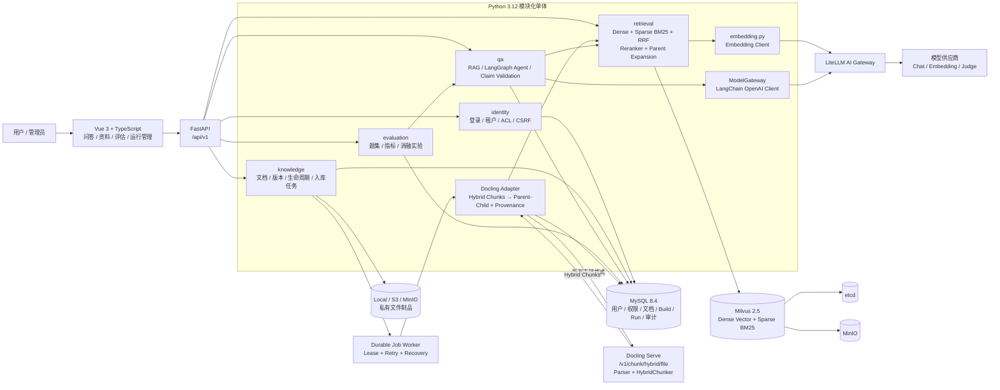
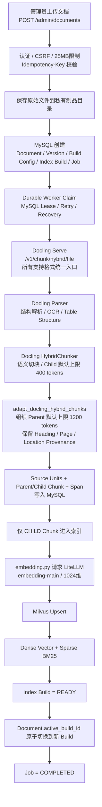
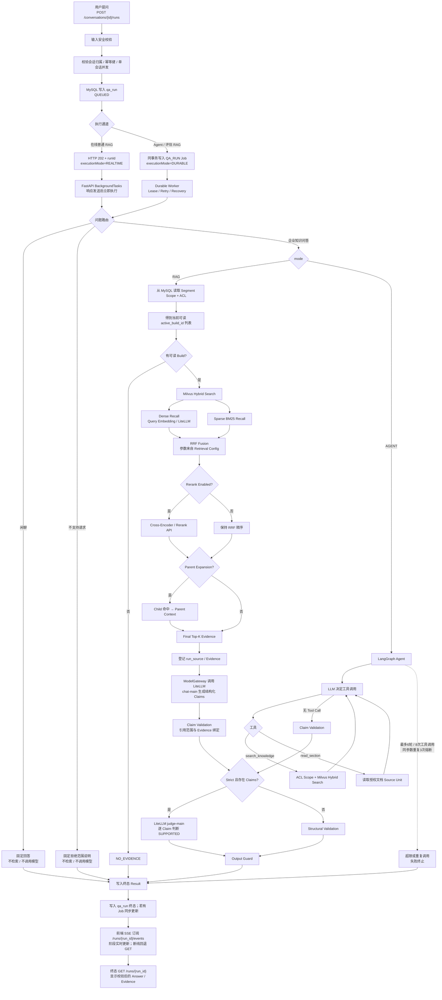

# 企业内部知识库项目

Python FastAPI 主业务、Milvus 向量与混合检索、LiteLLM AI Gateway（供应商 API 密钥由网关独立持有）、Docling 独立解析服务，面向运营、产品和技术共用的企业级内部知识库。前端简洁，重点是细粒度权限控制、文档全生命周期、混合检索策略、可追溯事实断言回答、自动化评测与故障恢复。旧 Java/Spring Boot/Elasticsearch 基线可通过 Git 历史标签或提交记录定位。

## 系统架构与核心流程

> 以下图基于当前 Python 实现整理。当前后端采用 FastAPI + MySQL + Milvus + LiteLLM；Markdown、TXT、PDF、DOCX、Office 等所有支持格式统一通过 Docling Serve 的 `/v1/chunk/hybrid/file` 完成文档解析与 HybridChunker 语义切块，后端再将 Docling Hybrid Chunks 适配为 Parent-Child 结构并保留标题、页码、来源位置等 provenance 信息。后台 INGEST/PURGE/Agent/EVALUATE 及评估 RAG 使用 MySQL 持久化 Job + Lease Worker；在线普通 RAG 只创建 qa_run，HTTP 202 响应后立即在 API 后台执行，不进入 Job 队列。进度通过 SSE 事件通道推送，最终答案在验证完成后展示。

### 系统架构图

架构中的关键约束：**MySQL 是权限与生效 Build 的权威来源**，Milvus 只保存可重建的检索索引；每次检索先从 MySQL 计算当前用户可读的 `active_build_id`，再把这些 Build ID 作为 Milvus 过滤条件，从源头避免越权召回。模型供应商密钥由 LiteLLM 独立持有，业务后端只调用内部模型别名。

### 文档入库流程图

### RAG / Agent 问答流程图

**问答执行模式**：浏览器普通 RAG 由 API 进程响应后直接启动，不创建 `QA_RUN` Job；Agent 和携带受信任 `evaluation_scope` 的评估 RAG 同事务创建 `qa_run + QA_RUN Job`，由 Worker 领取执行。两类请求均返回 HTTP 202，`qa_run` 始终记录状态和审计；现有 SSE 推送的是运行阶段，不是模型逐 Token。进程崩溃后在线普通 RAG 记为 `FAILED / PROCESS_RESTARTED`，持久化模式按 Job/Checkpoint 策略恢复。详见 [源码导读第 6 节](docs/source-walkthrough.md#6-普通-rag证据如何变成用户看到的答案)。

当前普通 RAG 与 Agent 的 `search_knowledge` 已统一走同一条 `RetrievalPipeline`：**ACL Scope → 可选 Rewrite / Multi-Query / HyDE → Dense + Sparse BM25 → 应用层 RRF → 可选 Reranker / MMR → 可选 Parent Expansion → 上下文预算与 Final Top-K → 外发前 ACL/Active Build 二次复核**。参数由不可变版本的 Retrieval Config 决定，`qa_run.config_id` 保存本次运行所用配置版本，便于消融实验、回放和回滚。Agent 仍使用两个只读工具：`search_knowledge` 与 `read_section`，并设置轮次、工具次数及重复调用熔断。两种问答模式的结构化结果都交给 `_verify_answer()`；strict 且有 claims 时调用 `judge-main`，要求判定完整覆盖每个 Claim 且全部为 SUPPORTED，否则失败关闭。

## 企业化增强（当前 main 实现）

- **统一权限真源**：Search API、普通 RAG、Agent 检索统一使用 `get_readable_build_records()`，同时覆盖租户、用户状态、KB ACL、文档 ACL、用户组和 active build。
- **TOCTOU 防护**：检索后、模型外发前再次核对当前权限与 `active_build_id`；权限撤销或版本切换时返回 `SOURCE_CHANGED`，不把失效来源发送给模型。
- **完整 Evidence Provenance**：Milvus Hit 返回真实 `kbId/documentId/versionId/buildId/chunkId`，并关联 `source_unit/location`；不再用 `allowed_build_ids[0]` 猜测来源。
- **配置驱动 Retrieval**：Dense/Sparse 候选数、RRF、Reranker、Parent Expansion、Final Top-K 均由版本化 Retrieval Config 控制。
- **Reranker + Parent Expansion**：Child Chunk 用于高精度召回，Reranker 精排后可扩展到 Parent Context，兼顾召回精度和生成上下文完整性。
- **统一 Docling + HybridChunker 入库**：Markdown、TXT、PDF、DOCX、Office 等所有支持格式统一调用 Docling `/v1/chunk/hybrid/file`；Docling 负责解析与 HybridChunker 子块切分，后端通过 `adapt_docling_hybrid_chunks()` 组织 Parent-Child 结构，并保留 Heading、Page、Doc Item、Location 等 provenance。默认 Child 上限为 400 tokens、Parent 上限为 1200 tokens，均可通过构建配置或环境变量调整。
- **在线问答分流**：在线普通 RAG 不再排队等待 MySQL Job Worker；提交后通过 FastAPI BackgroundTasks 立即执行，`qa_run` 保留状态、证据和审计，前端订阅 `/runs/{run_id}/events` SSE 进度并在断线时回退查询。模型当前仍生成完整的结构化 JSON，只有验证后的最终答案展示，尚非逐 Token 流式生成。
- **Durable Job Worker**：INGEST/PURGE/EVALUATE/Agent 及评估 RAG 继续使用 MySQL Job + Lease/Retry/Recovery；支持内嵌 Worker，也可执行 `python -m app.runtime.worker` 独立扩容。
- **对象存储**：Artifact Store 支持本地与 S3/MinIO，`RAG_ARTIFACT_STORE=s3` 即可切换。
- **Agent Runtime 原生化**：Agent 继续使用低层 `StateGraph` 保留 ACL / Evidence / Durable Job 等企业定制能力，但状态持久化与恢复切换到 LangGraph `Checkpointer + interrupt + Command(resume=...)`，上下文裁剪使用 LangChain `trim_messages` / `count_tokens_approximately`，不再维护平行的自研 checkpoint/resume 协议。
- **职责边界**：LangGraph/LangChain 负责图状态、HITL 恢复与消息裁剪；项目继续负责租户 ACL、Evidence Provenance、Durable Worker、运行预算、审计、评测和 Observability。
- **CI 基线**：GitHub Actions 执行 Python compile/pytest 与前端 type-check/test/build。

## 阅读顺序

若目标是理解当前 Python 项目并阅读主要源码，先看[源码导读：从上传文件到回答与评估](docs/source-walkthrough.md)，再看[RAG 评估完整说明](docs/rag-evaluation-guide.md)。下面的 PRD 与技术设计用于理解需求和设计意图，其中部分仍描述旧 Java / Elasticsearch 方案，当前行为以源码及这两份导读的核对基线为准。

1. [当前范围与交付顺序](docs/00-project-assessment.md)
2. [PRD-00 产品总览](docs/prd/PRD-00-product-overview.md)
3. [PRD-01 身份与文档权限](docs/prd/PRD-01-identity-and-access.md)
4. [PRD-02 文档解析与生命周期](docs/prd/PRD-02-document-lifecycle.md)
5. [PRD-03 检索、回答与证据](docs/prd/PRD-03-retrieval-answer-evidence.md)
6. [PRD-04 会话、取消与反馈](docs/prd/PRD-04-conversations-feedback.md)
7. [PRD-05 评估系统与策略实验](docs/prd/PRD-05-evaluation-experiments.md)
8. [PRD-06 运行管理与交付](docs/prd/PRD-06-operations-delivery.md)
9. [PRD-07 Agent 深入问答](docs/prd/PRD-07-agent-deep-qa.md)
10. [B0-B3 检索消融实验运行手册](docs/delivery/2026-09-13-retrieval-ablation-runbook.md)
11. [RAG 评估完整说明：方法、指标、执行流程与当前实现](docs/rag-evaluation-guide.md)

上述 PRD 按 to-spec 模板组织：问题、方案、用户故事、实现决定、测试决定、范围外事项及备注。它们综合已确认访谈，不代表已实现，也没有发布到外部 Issue Tracker。

## 当前确定的边界

- 内部系统、本地账号、固定维护管理员；文档级读权限由后端执行。
- 支持 Markdown/TXT、DOCX、PDF、FAQ、Wiki 导出文件及附件；扫描 OCR、图片描述和表格结构提取纳入范围。
- 全部约定策略均需实现并对照评测，不要求每次请求全部启用。
- 先使用模拟/确认脱敏资料；不自动导入或向在线模型发送公司正文。
- 先完成 PRD，再做技术设计，最后分阶段编码。代码全部由开发代理实现，并解释实际调用链和失败案例。

## 详细技术设计

从[技术设计入口](docs/design/README.md)开始，依次阅读架构、数据库与权限、入库状态机、检索与证据、API/会话/Agent、评估和实施验收。附件含 MySQL DDL 和 Milvus 集合映射；[验收追踪表](docs/design/08-traceability.md)逐条对应 81 项 PRD 验收。

当前代码已完成 Python/FastAPI + Milvus + Docling HybridChunker 主链路。真实 MySQL/Milvus/Docling/LiteLLM 联合验收与 B0-B3 模型消融仍应在独立 evaluation 环境执行；在生成并核对真实运行报告前，不应把静态追踪或测试通过表述成真实模型效果已经验证。

## 资料组织

当前已有 README、范围文档、PRD、技术设计、后端、前端、部署脚本和评测框架：

- docs/design：详细技术设计。
- docs/decisions：取舍与技术决策。
- docs/learning/sources、concepts、practice：来源笔记、概念笔记、实际问题与验证。
- docs/delivery：部署、验收、演示和真实项目成果。
- backend、frontend：Python FastAPI 后端和功能页面。
- datasets、experiments：授权样本、题集、策略配置和脱敏报告。
- deploy：部署与初始化资料。

原始公司文件、上传数据、运行数据库、敏感日志和密钥不提交版本库。所有资料均遵循租户及文档权限。
