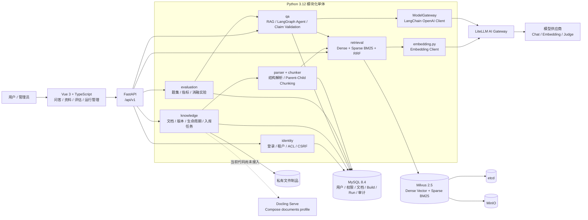
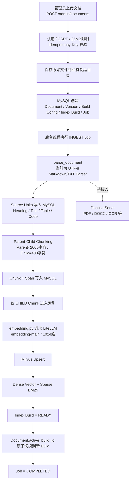
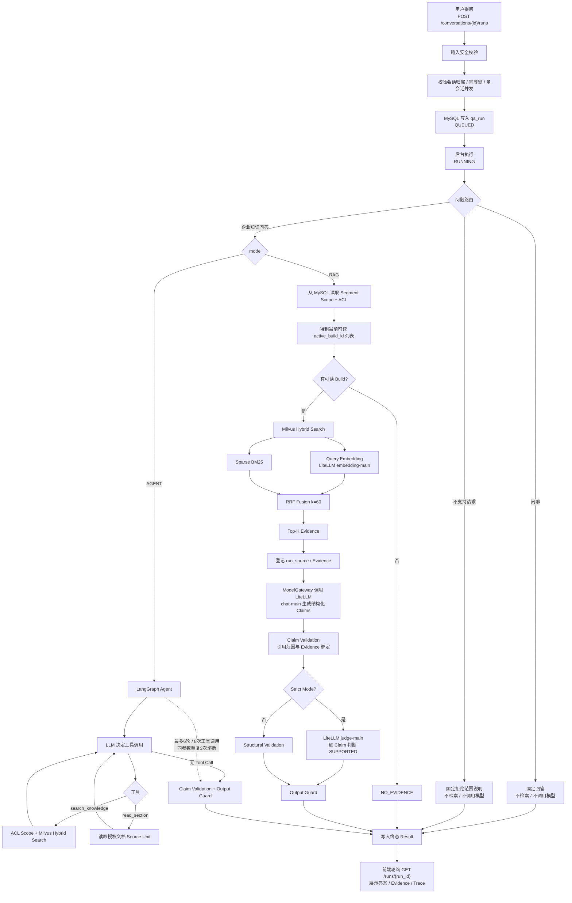

# 企业内部知识库项目

Python FastAPI 主业务、Milvus 向量与混合检索、LiteLLM AI Gateway（供应商 API 密钥由网关独立持有）、Docling 独立解析服务，面向运营、产品和技术共用的企业级内部知识库。前端简洁，重点是细粒度权限控制、文档全生命周期、混合检索策略、可追溯事实断言回答、自动化评测与故障恢复。旧 Java/Spring Boot/Elasticsearch 基线可通过 Git 历史标签或提交记录定位。

## 系统架构与核心流程

> 以下图基于当前默认分支 `feat/python-migration` 的实际 Python 实现整理。当前后端已迁移到 FastAPI + MySQL + Milvus + LiteLLM；`deploy/compose.yml` 已提供 Docling Serve，但当前 `backend/app/knowledge/parser.py` 仍使用 UTF-8 Markdown/TXT 解析器，Docling 尚未接入实际入库调用链。

### 系统架构图

架构中的关键约束：**MySQL 是权限与生效 Build 的权威来源**，Milvus 只保存可重建的检索索引；每次检索先从 MySQL 计算当前用户可读的 `active_build_id`，再把这些 Build ID 作为 Milvus 过滤条件，从源头避免越权召回。模型供应商密钥由 LiteLLM 独立持有，业务后端只调用内部模型别名。

### 文档入库流程图

### RAG / Agent 问答流程图

当前普通 RAG 主链路的检索实现是 **Dense + Sparse BM25 → RRF → Top-K**；代码中尚未接入独立 Cross-Encoder Reranker 或 MMR，因此图中没有把它们画成已实现步骤。Agent 模式使用两个只读工具：`search_knowledge` 与 `read_section`，并设置轮次、工具次数及重复调用熔断，防止无界循环。

## 阅读顺序

1. [当前范围与交付顺序](docs/00-project-assessment.md)
2. [PRD-00 产品总览](docs/prd/PRD-00-product-overview.md)
3. [PRD-01 身份与文档权限](docs/prd/PRD-01-identity-and-access.md)
4. [PRD-02 文档解析与生命周期](docs/prd/PRD-02-document-lifecycle.md)
5. [PRD-03 检索、回答与证据](docs/prd/PRD-03-retrieval-answer-evidence.md)
6. [PRD-04 会话、取消与反馈](docs/prd/PRD-04-conversations-feedback.md)
7. [PRD-05 评估系统与策略实验](docs/prd/PRD-05-evaluation-experiments.md)
8. [PRD-06 运行管理与交付](docs/prd/PRD-06-operations-delivery.md)
9. [PRD-07 Agent 深入问答](docs/prd/PRD-07-agent-deep-qa.md)
10. [B0-B3 检索消融实验运行手册](docs/delivery/2026-09-13-retrieval-ablation-runbook.md)

上述 PRD 按 to-spec 模板组织：问题、方案、用户故事、实现决定、测试决定、范围外事项及备注。它们综合已确认访谈，不代表已实现，也没有发布到外部 Issue Tracker。

## 当前确定的边界

- 内部系统、本地账号、固定维护管理员；文档级读权限由后端执行。
- 支持 Markdown/TXT、DOCX、PDF、FAQ、Wiki 导出文件及附件；扫描 OCR、图片描述和表格结构提取纳入范围。
- 全部约定策略均需实现并对照评测，不要求每次请求全部启用。
- 先使用模拟/确认脱敏资料；不自动导入或向在线模型发送公司正文。
- 先完成 PRD，再做技术设计，最后分阶段编码。代码全部由开发代理实现，并解释实际调用链和失败案例。

## 详细技术设计

从[技术设计入口](docs/design/README.md)开始，依次阅读架构、数据库与权限、入库状态机、检索与证据、API/会话/Agent、评估和实施验收。附件含 MySQL DDL 和 Milvus 集合映射；[验收追踪表](docs/design/08-traceability.md)逐条对应 81 项 PRD 验收。

下一步继续 F5：恢复 Docker 后运行无模型 HTTP 集成，随后在独立 evaluation 环境绑定题集来源，并按固定 B0-B3 配置完成真实模型消融评估。不要把 81 项静态追踪写成 81 项运行验收通过。

## 资料组织

当前已有 README、范围文档、PRD、技术设计、后端、前端、部署脚本和评测框架：

- docs/design：详细技术设计。
- docs/decisions：取舍与技术决策。
- docs/learning/sources、concepts、practice：来源笔记、概念笔记、实际问题与验证。
- docs/delivery：部署、验收、演示和真实项目成果。
- backend、frontend：Python FastAPI 后端和功能页面。
- datasets、experiments：授权样本、题集、策略配置和脱敏报告。
- deploy：部署与初始化资料。

原始公司文件、上传数据、运行数据库、敏感日志和密钥不提交版本库。所有资料均遵循租户及文档权限。
