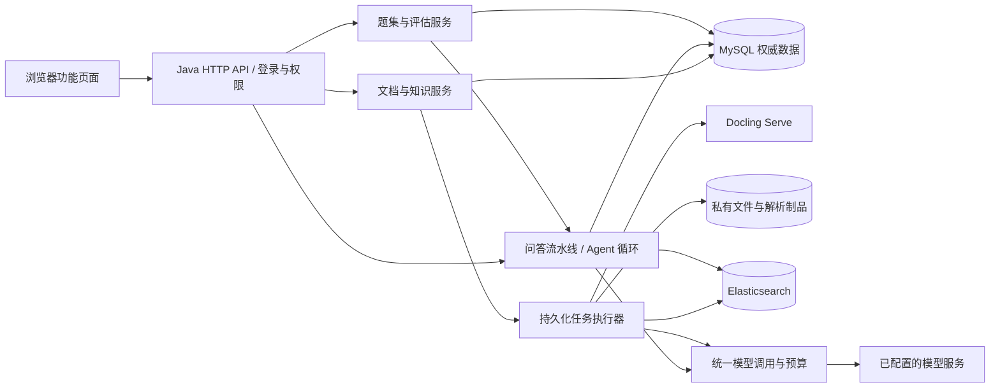

# 架构与技术选型

对应 PRD-00/01/06；完整流程同时服务 PRD-02～07。所有容量与参数是第一轮实验起点，不是已测性能。

## 1. 总体结构

采用 Java 模块化单体，按业务包分工；异步执行器与 HTTP API 首版在同一进程。没有新增微服务治理、Redis、MQ 或 Kubernetes。Docling 为唯一独立解析服务，Elasticsearch 同时承担 BM25 和 Dense 检索，避免维护第二套向量数据库。

浏览器只访问 Java；数据库、ES、Docling、文件目录不对浏览器公开。生产式演示通过同源 HTTPS 入口，开发 localhost 可使用受限本地配置。运行日志与原文制品分开。

## 2. 选型与锁版规则

| 部分 | 设计选择 | 具体作用与边界 |
|---|---|---|
| 业务语言 | Java 21 LTS | 用户主要学习业务调用链，无需手写 Python 解析逻辑 |
| Web | Spring Boot 4.0.x、MVC、Validation、Spring Security | 同源 API、服务端登录态、参数校验；不是全响应式架构 |
| 模型调用 | Spring AI 2.0.1 `spring-ai-openai`，供应商能力通过 ModelGateway 接入 | Chat、Embedding、Vision、Judge 使用 Spring AI；Reranker 使用供应商扩展端点；权限、检索融合、Agent 循环自己实现 |
| 持久化 | MySQL 8.4、Spring JDBC、Flyway | 显式 SQL 便于解释 ACL、行锁和发布事务；不叠加 ORM |
| 搜索 | Elasticsearch 9.x 对应稳定补丁 | Java REST 客户端与服务端锁定同一兼容系列；原文与向量双索引 |
| 解析 | Docling Serve 固定 CPU 镜像摘要 | HTTP 异步解析 DOCX/PDF/HTML，扫描 OCR、表格、图片资产；Java 处理业务协议 |
| 原文件 | 单机私有持久目录 | 数据库 artifact 表登记；禁止静态路径直出；暂不增加对象存储服务 |
| 前端 | Vue 3 + TypeScript + Vite + Element Plus | 登录、资料管理、问答、评估、运行详情；不做复杂视觉设计 |
| 测试 | JUnit、Spring API 集成测试、Testcontainers，少量浏览器流程 | 模型使用可控替身验证工程行为，真实模型使用冻结评测验证质量 |

Spring AI 2.0.1 通过官方 BOM 锁版，并已与本项目 Spring Boot 4.0.3、JDK 21 完成依赖解析、编译和模型网关契约测试。Spring AI 官方兼容说明列出 2.0.x 对 Boot 4.0.x/4.1.x 的支持。[官方兼容说明](https://docs.spring.io/spring-ai/reference/getting-started.html)

C1 必须生成锁版清单：JDK 发行版/版本、Maven Wrapper、Boot/AI/客户端/数据库/ES 版本、Docling 镜像 digest 与 OpenAPI hash、前端 lockfile。禁止以 latest 标签完成交付；解析 SDK 字段以该镜像真实 OpenAPI 为准。

## 3. 模型配置

配置为 CHAT、EMBEDDING、RERANK、VISION、JUDGE 五种用途，可共用已验证服务，不能假设所有 OpenAI-compatible 端点都支持重排或图片。每项保存 endpoint 标识、准确 model ID/revision、上下文上限、token 计数方式、超时、价格版本；密钥只从环境变量读取。

当前实现直接依赖 `spring-ai-openai`，由 `ModelGateway` 根据 `MODEL_BASE_URL`、`MODEL_API_KEY` 和各用途 model ID 构造 `OpenAiChatModel`/`OpenAiEmbeddingModel`。没有启用 starter 自动配置，因此缺少密钥时应用仍可启动，真正发起模型调用才返回 `MODEL_NOT_CONFIGURED`。Spring AI 内部重试设为 0，429/5xx 的三次有限重试、调用 deadline、并发槽位、来源权限复核和预算预留/结算继续由统一网关负责，避免两层重试导致费用与 attempt 账本失真。客户端能力与配置字段见[官方 OpenAI Chat 文档](https://docs.spring.io/spring-ai/reference/api/chat/openai-chat.html)和[官方 OpenAI Embedding 文档](https://docs.spring.io/spring-ai/reference/api/embeddings/openai-embeddings.html)。

Chat、Rewrite、HyDE、Multi-Query、答案生成和 Judge 统一走 `OpenAiChatModel`；图片数据先转换为 Spring AI `Media`；Embedding 走 `OpenAiEmbeddingModel` 并继续执行数量、顺序、维度、有限数值和非零模长校验。Agent 的工具 JSON Schema 转成 Spring AI `ToolCallback` 供模型生成 tool calls，但工具执行仍由 `QaService` 的受控循环完成，以保留逐次权限、取消、预算、重复调用熔断和证据登记。Reranker 的 `/rerank` 不是该 OpenAI Chat/Embedding 客户端的标准能力，保留 `HttpClient` 薄适配并复用同一网关生命周期。

Embedding 的参考候选为 BGE-M3 的 Dense 表示，维度 1024；不使用其 Sparse 头冒充本项目 BM25。模型卡给出 1024 维，本设计的向量 JSON 因此使用 1024 作为样例。实际选用服务仍须验证模型、输入截断、归一化及返回维度，变更模型需要新索引族和重建。[模型卡](https://huggingface.co/BAAI/bge-m3)

聊天、重排、视觉和裁判的具体供应商尚未选定：未提供账号/密钥，不能编造可用性或费用。C1 可先在隔离测试中用固定响应跑通；真实质量报告必须使用真实模型并记录这些字段。本地部署 BGE 或视觉模型不是现有硬件已满足的事实。

## 4. 业务边界

| 包/服务 | 所有权 | 不应承担 |
|---|---|---|
| identity / AccessPolicy | 登录、用户组、租户、KB 与文档授权求值 | 用模型决定权限 |
| knowledge / IngestionService | 原文件、版本、来源单元、构建与发布 | 直接信任解析器的外部 URL |
| retrieval / RetrievalService | 查询增强、授权候选、RRF/重排/MMR/父扩展 | 向普通用户暴露受限候选 |
| answer / AnswerService | 上下文、claims、验证、答案呈现 | 事后搜索猜测引用 |
| conversation | 本人会话、上下文段、消息依赖、反馈 | 共享 default 会话 |
| evaluation | 冻结题集、执行业务服务、评分与对比 | 私自复制一套检索逻辑 |
| agent | 两个只读工具、循环、终止 | DAG、Shell、任意插件执行 |
| runtime | 持久任务、trace、预算、审计、删除清单 | 在普通日志打印正文或密钥 |

初始代码可全部在一个 Maven 应用内按包组织。只有模型/解析/搜索外部边界需要可替换测试客户端；不为每个类建立接口或注册工厂。

## 5. 两条主调用链

上传：管理员鉴权 → KB 阅读检查 → 校验文件/登记版本和任务 → 私有制品 → 解析 → 质量门 → 分块与表示 → Embedding → 双索引写入并核对 → SQL 原子发布。老版本保持服务至新构建完整可检索。

问答：输入安全检查 → 本人会话锁 → 请求/预算登记 → 规则优先的问题路由 → 当前权限与生效构建快照 → 安全历史 → Query 策略 → 检索 → 权威复核 → 重排/扩展 → 登记实际外发来源 → 生成 → 引用/可选语义验证 → 输出安全检查 → 当前权限复核 → 原子终态提交。闲聊和明确不支持的通用助手请求返回固定文本，不进入检索或模型调用；其他问题默认进入知识检索，路由器不参与权限判定。

这里的快照固定本次检索对象，不冻结用户权限；撤权始终优先。本次用于事实检索的生效构建变化时中止为 SOURCE_CHANGED，请求者重发，不混合新旧版本。HISTORY 用途的旧来源仅协助理解指代，无须仍是 active build，但必须仍有阅读权限，且不能作为当前事实依据。已完成历史可显示仍获授权的旧版本。

## 6. 第一版容量边界

起始演示目标：一个主要租户、第二测试租户、三个业务组；约 30 道冒烟题到约 100 道冻结题；先用小型模拟语料。每次搜索最多 10,000 个授权生效 build ID，超过返回 SCOPE_TOO_LARGE，要求缩小范围；这是显式实现边界，未来再设计 ACL 位图/搜索授权投影。

单实例权限闸门、MySQL 任务队列和本地文件是有意选择的单机方案。增加实例前需更改权限撤销并发协议、共享文件和任务连接中断机制，不能直接扩副本就称高可用。
