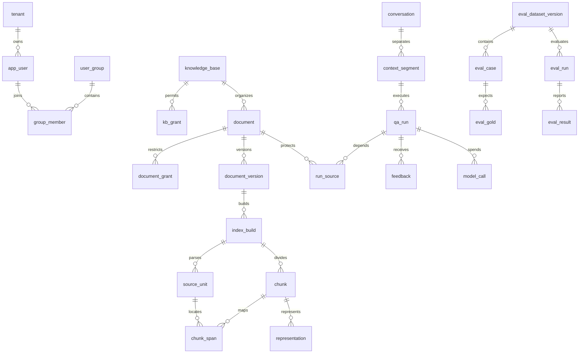

# 数据库、权限与一致性

> **历史设计说明（2026-09-22）**：本文保留早期技术设计基线，其中可能包含 Java、Spring、Elasticsearch、旧 Docling API/切块方案或尚未落地的设计，不代表 `main` 当前实现。当前系统行为请以仓库根目录 `README.md`、`docs/source-walkthrough.md`、`docs/rag-evaluation-guide.md` 与 `backend/app` 源码为准。

对应 PRD-01～07。数据库目标 MySQL 8.4/InnoDB/utf8mb4；[schema.sql](schema.sql) 是设计 DDL，未执行。首版以关系字段约束身份、权限与归属；JSON 只存版本化策略、解析定位、结构化输出和诊断，不能用 JSON ACL 代替可审计授权表。

## 1. ER 与聚合

图省略了审计、会话凭据、制品、配置、队列及预算关系，完整字段与外键见 SQL。所有业务表使用 (tenant_id,id) 复合主键；跨实体关系带 tenant_id。UUID 由应用生成，首版 CHAR(36) ASCII 二进制排序，易读性优先于紧凑存储。tenant 之外没有无租户的业务资源。

## 2. 数据字典与关键索引

| 表组 | 关键字段及作用 | 约束/访问索引 |
|---|---|---|
| tenant、app_user、auth_session | security_epoch；账号/密码 hash/维护标识；会话 token_hash/过期/撤销 | 租户内 login_name 唯一；token hash 全局唯一；凭据不存原 token |
| user_group、group_member | 用户组与成员 | 同租户 FK，成员不重复 |
| knowledge_base、kb_grant | KB 名称/状态/乐观锁；ALL/GROUP/USER 允许项 | 每主体一条 grant，类型与 user/group 空值组合 CHECK |
| document、document_grant | KB/ACL 模式/状态/active_build_id/lifecycle_epoch/row_version | KB 列表索引；当前构建必须属于同一文档；权限不随版本冻结 |
| artifact | document/storage_key/kind/hash/大小/清理状态 | 存储键唯一；物理路径只从登记的私有键拼接 |
| document_version | document/version_no/source_artifact/source_hash | 每文档版本号唯一；原文件与版本同文档 |
| index_build | version/build_no/config/status/model/dims/capabilities/fence | 同版本构建号唯一；active pointer 只指向同文档构建 |
| source_unit | build/unit_key/kind/text/location/machine_generated/artifact | 单元 key 在构建内唯一；图表/坐标存 location JSON |
| chunk、chunk_span | parent/child/token_count/text；多个单元区间映射 | 父子同构建；span 起止 CHECK；层级/无环由服务验证 |
| representation | chunk/type/ordinal/text/hash/vector/dims/model | 每 child 的类型/序号唯一，Original ordinal=0；向量是 float32 LE BLOB |
| config_revision | kind/name/revision/hash/payload | 不可变发布版本；同名版本唯一；不保存 secret |
| job | kind/目标/status/stage/租约/checkpoint/错误 | (status,available_at,lease_until) 队列索引；幂等 key 唯一 |
| conversation、context_segment、segment_kb | 所有者/状态；段号/范围模式；显式选中 KB | 同段 scope 固定，切换新建段；ALL 不保存伪造通配 KB |
| qa_run | 段/轮次/状态/阶段/配置/问题/结果/终止原因/取消时间 | 同会话最多一个活动 run 的生成列唯一索引；用户幂等键唯一 |
| run_source、run_dependency、run_event | 所有实际来源与前序依赖；阶段事件 | 按 document 查受影响运行；来源不是只记最终 citations |
| feedback | run/提交者/rating/问题类型/状态/文本 | 同用户每 run 一条反馈，可更新并留审计 |
| tenant_budget、budget_reservation、model_call | 月份/预算；跨执行环境的预留；本地用途/尝试/用量 | 权威预算行锁；reservation 按调用 ID 幂等；本地 model_call 保存 reservation authority/ID |
| eval_dataset_version、eval_case、eval_gold | 冻结版本/题目/身份/事实组与原文锚点 | 冻结后不可原地修改；证据锚点不绑定 chunk ID |
| eval_snapshot、eval_snapshot_document | 隔离语料/ACL/构建清单与原始来源 lineage | 原源系统+tenant+document 可定位清理，跨物理库不设伪 FK |
| eval_run、eval_result、eval_review | 配置/环境/状态；逐题业务 run/分数；人工复核 | 同实验同题同重复序号唯一；保留原自动判定 |
| audit_event、deletion_record | 无正文动作/对象/结果；待清理来源与域确认 | 按对象和时间查审计；删除清单必须独立备份 |

浮点向量制品保存在关系库 BLOB 是小规模的有意简化：单个 1024 维向量约 4 KiB，不含索引开销；实际总量按表示数增长。向量写入前验证字节数=4×dims、有限数值、非零范数及模型一致。大量数据时再迁移专用制品文件，不将 SQL 当在线相似度搜索引擎。

## 3. 权限公式

从登录态得到 tenant T、user U，查询当前组集合 G：

KBRead(U,K) = K.LIVE AND (允许 ALL OR 允许 U OR 允许 G 中任意组)

DocRead(U,D) = D.LIVE AND KBRead(U,D.KB)
AND (D.acl_mode=INHERIT OR 允许 U OR 允许 G 中任意组)

document_grant 不提供 ALL；需要对 KB 全体开放时用 INHERIT，RESTRICT 仅支持 user/group。新上传默认 RESTRICT，给上传管理员显式用户读权；上传前要求其本身可读 KB，不能为了上传悄悄扩大 KB 范围。

维护资格：U.is_admin AND 资源同租户；它允许修改 ACL、管理任务/文档元数据，但不绕过 DocRead 读取正文。管理员无阅读权限时只看不含标题/正文的必要管理 ID 与状态；可显式自授权并审计。

普通用户不存在/越权资源统一 404 RESOURCE_NOT_FOUND；未登录 401，无维护资格 403 OPERATION_FORBIDDEN。ACL 更新检查 expected row_version，冲突 409。全部授权变更（含组移除、KB 变更、用户停用）同事务 security_epoch++ 并留审计。

## 4. 并发撤权与内容闸门

仅“读权限 → 很久后发送”有 TOCTOU 窗口。首版单实例采用每租户读写闸门：
- 内容外发/HTTP 正文序列化取读闸门，读取最新 authority，登记来源并完成本次有限大小 payload 提交后释放；不持有到等待模型响应结束。
- ACL、成员、状态变更取写闸门，在短 SQL 事务提交后释放。已获准提交的在途内容不能撤回，撤权提交之后的新内容提交必须被拒绝。
- 对于异步 HTTP 客户端，必须有“请求体已提交/失败”的可观测边界；若库无法提供，则保持闸门至调用返回/超时，接受较慢撤权，不能假装原子安全。
- 回答终态提交与权限/取消检查在同一保护边界完成；最终 GET 每次重新鉴权。数据库不可用即失败关闭。
- 不保持数据库事务跨模型调用。所有应用写权限的入口共用闸门；直接数据库管理员操作不在产品威胁模型内。

初版不使用长期 ACL 缓存。security_epoch 是变化检测与复核触发器，不是让旧权限生效的许可证。双实例部署前须改为跨实例协调或有明确撤权时效的协议，当前设计禁止未改协议就横向扩容。

tenant.active_retrieval_config_id 指向本租户当前默认策略，发布/回退只原子切换该指针并审计，不原地修改历史 config_revision。qa_run.budget_json 保存本 run 的总调用/token/工具计数与上限，嵌套服务复用该 run，不能通过新建工具预算绕开。

## 5. 历史、引用与副本授权

run_source 保存调用实际使用的全部来源及 purpose：HISTORY、RERANK、CONTEXT、VISION、JUDGE、TOOL，数据可重复但来源集合去重求权限。先登记依赖再外发，防止响应到达前删除无法定位副本。

历史答复可见须：本人会话 + 所有来源仍可读/未删除。历史 build 无须仍为 active，但原文版本必须存在，页面注明旧版。引用 API 从 run 的 evidence ID 找实际来源，不接收客户端任意替换文档路径。

若某 run 任意来源不可读，则本条和该 context segment 后续助手答复保守隐藏；后续创建请求只用当前合法段视图。恢复授权可以重新求值得到可见，不永久伪改正常运行状态为失败；彻底删除已清掉正文则不能恢复。

反馈、候选轨迹、评测详情包含引用资料时采用相同来源守卫。普通日志与审计只记录 ID、数量、错误分类，不能借错误字符串泄露正文。

## 6. 事务边界

| 动作 | 同事务内容 | 事务外内容 |
|---|---|---|
| 上传登记 | document/version/artifact 元数据、job、审计 | 文件暂存/校验；失败孤儿制品由登记清理任务回收 |
| 发布 | 锁 document + 检查 fence/状态/版本，切 active pointer、审计 | ES Bulk、refresh、完整性核查在此前完成 |
| 发起问答 | 会话锁、幂等检查、段/轮次/run、新活动唯一键 | 模型与搜索；任务进度短事务更新 |
| 完成/取消 | 锁 run，比较状态，写唯一终态/结果 | 取消外部连接、释放在途预算的最终对账 |
| 预算预留 | 本地先登记 model_call；权威端锁 tenant_budget 并写 budget_reservation | 内部预留确认后才外发；usage 结算另一个幂等短事务 |
| 彻底删除登记 | 设 PURGE_PENDING、epoch++、删除记录、job | 文件/ES/副本清理和域确认 |

死锁仅对短幂等事务最多重试两次，按固定资源顺序（tenant budget/document/conversation/run）取所需锁，禁止持有会话锁等待模型。唯一冲突的幂等请求返回已有 run，而不是产生第二份调用。

## 7. SQL 附件边界

SQL 不含真实账号、公司文件、供应商密钥、DROP DATABASE 或自动建库。执行时由 Flyway 管理并只连接显式创建的项目库。状态转换、JSON schema、层级无环、管理员资格、发布就绪以及冻结禁止修改属于服务约束，需要集成测试，不能宣称外键已全部证明。

预算的 budget_reservation 保存在唯一权威实例，通过 caller_environment/caller_call_id 对应调用；它不伪造跨物理数据库 run 外键。各执行环境的 model_call 仍用本地 run/job 外键确保内容归属，并保存权威 reservation ID。预留请求响应丢失时以同一调用 ID 查询/重试，不能另申请额度；失败前未发模型的预留可安全释放，UNKNOWN 必须对账。全局在途数由权威端活动预留统一计数。

artifact 到来源文件、当前 build 的循环关联通过末尾 ALTER TABLE 增加；逻辑删除保留墓碑，正文清理按依赖顺序显式执行，不滥用全链 CASCADE。跨环境评测 lineage 不使用跨库外键，采用清理确认协议。

本版静态检查覆盖表/列/FK目标与本地链接；MySQL 执行、并发锁行为、索引 Explain 与 ES 契约都留到 C1/C2 真实集成验收。
