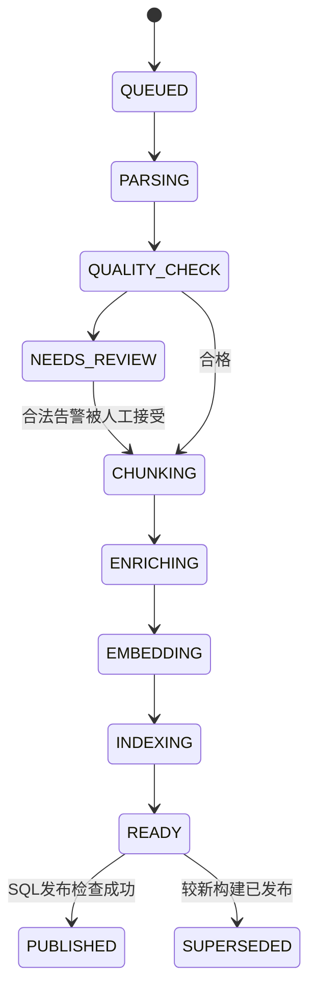

# 文档入库、解析与生命周期

对应 PRD-02、01、06。重要区分：document 是权限对象；version 是一次原文件内容；build 是该版本的一次解析/分块/模型配置构建。

## 1. 格式与解析契约

| 输入 | 入口与规范化 | 特殊处理 |
|---|---|---|
| Markdown / TXT | Java 读取 UTF-8、Markdown AST，标题/段落/代码块 | 编码失败报错；禁止执行代码或跟随任意链接 |
| FAQ | UTF-8 JSONL，question/answer 必填，按问答单元组织 | 文本与原始行号保存，问答不拆开；缺字段逐条报错 |
| DOCX / PDF | 上传至 Docling Serve，接收结构化 JSON 与资产 | 文本、表格、图片和页/框定位；扫描件启用 OCR |
| Wiki | 上传导出 HTML/MD 和附件包 | HTML 只解析，脚本不执行；页面归一化为独立文档 |
| 图片 / 表格 | 从已登记父文档提取 | 原图、OCR/机器描述、单元格结构都登记同一 document |

Docling 异步文件转换入口是 POST /v1/convert/file/async；Java 保存 external_task_id 并轮询任务。实际任务状态/结果路径及选项名称从锁定镜像 OpenAPI 生成契约测试，不能照着最新版文档猜字段。[官方使用说明](https://github.com/docling-project/docling-serve/blob/main/docs/usage.md)

服务仅内网可达，启用认证，Java 不使用任意 URL 转换入口。Docling 默认本地执行引擎足够，Java 的 MySQL 任务记录才是持久业务真相；服务丢失任务时用同一输入重新提交。必须显式配置文件大小和页数，不能依赖未设限的默认值。[配置说明](https://github.com/docling-project/docling-serve/blob/main/docs/configuration.md)

Unstructured 只是备选：若锁版 Docling 的特定格式契约测试失败，先记录失败样本，再通过新设计决策更换该解析路径。首版不双写两个解析器。

## 2. 输入保护与初始配额

初始：单文件 25 MiB、PDF 200 页、单次导入 100 文件、附件包解压后 250 MiB/1,000 项、单文档最多 50 张待描述图片；都可由管理员降低。超限进入明确错误或需拆分，不静默截取后发布完整文档。

扩展名、MIME、魔数交叉检查；文件名仅展示，存储名为随机 ID。ZIP 禁止绝对路径、..、符号链接、嵌套压缩包和越界解压，限制压缩比 100:1；服务端重新计算真实大小。PDF/HTML 的远程资源不下载。危险 HTML/SVG 不内联展示；预览做净化或安全转换。

目录导入只接受管理员预先配置的 import_root 下相对路径，解析最终绝对路径并拒绝 symlink/junction/reparse point；不接收任意盘符路径。导入先预览清单和预算再提交；源码仓库不是默认目录。选择哪些原文件需要导入必须显式表达。

资源限制同样在 Docling 容器设置 CPU/内存/并发；初始解析并发 1、入库任务 1。硬件尚未实测，OOM 转成可恢复任务错误。公司原文未获准外发，不能为图片描述隐式使用在线服务。

## 3. 不可变来源表示

每次解析形成 source_unit：TEXT、CODE、TABLE、IMAGE 或 HEADING。字段包含 version/build、unit_key、原文本、机器生成标记、heading_path、页号/边界框、字符范围或表格坐标、原始 artifact 与内容 hash。

同一原文件可被不同解析器产出不同 unit；跨构建评估锚点优先使用原版本内容 hash + 页/框/行号/段落引用及 quote hash，不把解析器随机 unit ID 当永恒坐标。映射失败进入标注复核，不记为检索未命中。

Docling JSON、规范化单元、原图、表格 JSON/展示 HTML 都保存为私有制品。视觉描述引用原图并显示“机器描述”；描述不伪装成人写原文。OCR 也是机器解析，保留 PDF 原页供核查。视觉服务由 Java 统一模型入口调用，避免 Docling 隐式外发绕过预算。

PDF 有可靠页号时记录页号；DOCX/HTML/MD 无可靠分页时只记录标题路径、段落序号/行号及 quote hash，禁止编造页码。质量门的确定性硬失败包括整文无可读单元、资产越界、来源映射无效、缺必需阶段。页处理失败、含明显文字图像却无 OCR、表格行列关系丢失、图描述失败属于带位置的告警并进入 NEEDS_REVIEW。置信分数只在对应解析器定义可解释时使用，不统一设一个“0.8 就合格”的伪通用阈值。

## 4. 分块和多表示

结构化分块从标题层级生成 parent，从段落/列表/代码/表格生成 child。初始目标 child 450 token、overlap 最多 60 token、parent 1,500 token；具体 tokenizer、上限与算法版本写入 build config。

优先完整规则/步骤/表头，长块只在允许边界拆分。无法安全拆分的超大表格按行组加重复表头、单位和标题；合并单元格保留关系，跨页重复表头去重。超长代码保留位置和语言，不能宣称截断后的代码可执行。硬上限冲突进入质量告警，不宣称绝对不会截断语义。

chunk_span 记录 chunk 与实际 source_unit 范围，多段拼接仍可定位；复制的标题不算新原文。parent/child 必须同 build，父链无环且仅一层 parent→child，数据库外键限制同租户同构建，服务验证层级。

每个 child 为 canonical chunk：
- Original：规范原文加必要标题，一条表示。
- Summary：只概括该 child，一条表示，不能引入其他文档事实。
- Questions：根据该 child 生成最多三条非重复假设问题；缺失时必须记录是失败还是审查后合法零条，不默认声明 Questions 已就绪。
- Parent 只做上下文扩展，首版不另建父摘要树。

包含 Questions 的发布配置要求每个有效 child 至少一条合格问题表示；摘要/问题生成不读取评测题。引用永远回到 source_unit，生成表示只负责召回。

## 5. 状态机与发布事务

任一执行阶段可进入 RETRY_WAIT、FAILED 或 CANCELLED；重试返回持久 checkpoint 对应阶段，不从头无控制重复。空内容、路径安全失败、无法定位原文、缺必需表示不能人工强行接受。NEEDS_REVIEW 保存 warning code、页/单元、预览及管理员接受理由；权限预览与正文相同。

publish 的前置条件：
1. 原始制品及规范化制品 hash 合格，质量门通过。
2. config 要求的每种表示与向量完成，维度/模型一致。
3. 双索引逐项 Bulk 成功，refresh 后按 build 检查实际 ID 集合与计数、抽样查询。
4. 事务 SELECT document FOR UPDATE，校验 LIVE、lifecycle_epoch 等于任务 fence、任务租约 epoch 有效。
5. 按 (version_no, build_no) 与当前构建比较，只有更新的目标可以发布；同一输入重试不额外发布。
6. 更新 document.active_build_id、row_version 和发布审计，同一事务提交；READY 但未获发布资格记 SUPERSEDED。

ES 写入成功、SQL 未提交时留下不可见 build；重试核对后发布。SQL 提交前不能让 ES alias 提前切成用户可见“当前版”。ES 文档 _id 使用表示/child ID，重复写覆盖同一内容；不能生成重复有效记录。

## 6. 持久任务与故障恢复

job 具有 kind、target_id、status、stage、attempt、available_at、lease_until、lease_epoch、fence、checkpoint 和错误码。任务领取在短事务中 SELECT ... FOR UPDATE SKIP LOCKED，更新租约后提交；外部调用不持有行锁。MySQL 官方说明 SKIP LOCKED 可跳过已锁行，适合这里的队列领取，但不用于普通一致性读取。[锁定读说明](https://dev.mysql.com/doc/refman/8.4/en/innodb-locking-reads.html)

初始租约 60 秒、每 15 秒心跳；每次结果落地 CAS 校验 epoch。过期任务可重领，旧 worker 即使收到成功响应也不能推进阶段或发布。外部服务不保证 exactly-once：已计费未落盘可能重算，模型调用账本要保存每次尝试。

每阶段最多 3 次总尝试，短暂 429/5xx/连接失败指数退避 1、2 秒加抖动且遵守 Retry-After/总时限；语法/权限/不支持格式不重试。管理员 retry 创建新 attempt checkpoint，保留原失败记录和关联，禁止改变已发布构建内容。

## 7. 删除、恢复与彻底删除

document.status = LIVE / TRASHED / PURGE_PENDING / PURGED，与 build 执行状态分开。
- 回收站：事务加锁，设 TRASHED、lifecycle_epoch++、记录审计；新搜索 allow-list 立即排除。当前构建可保留用于恢复。
- 恢复：仅 TRASHED，可检查原件/索引/ACL 后恢复 LIVE；索引损坏保持 TRASHED 并发 RESTORE 任务，仅重建已保留构建的索引制品。重建成功后在恢复事务校验当前 fence/状态，原子设 LIVE；它不调用要求 LIVE 的普通发布事务。不能“恢复成功但搜索空”，旧任务 fence 不恢复。
- 彻底删除：进入 PURGE_PENDING 并写独立删除清单，马上不可读；持久 purge job 分阶段删除 ES、文件、chunk/向量、运行内容及评测副本。不可回收恢复。
- purge 完成必须验证各存储不存在可读正文，标记 PURGED；保留无内容 document 墓碑和最小审计。失败重试，不把“已排队”描述为“已清除”。

所有可含资料正文的派生运行在 run_source 中关联文档；不只关联最终引用。对关联运行清空问题/答案/事件 payload/模型响应、反馈文本及评测结果内容，保留 ID/状态/计数。若整段后续对话依赖该运行，同段后续运行一并清理。

评测快照有 origin lineage；purge 通知隔离实例，未收到确认则不得宣称全域清理完毕。离线备份最长 7 天到期，恢复前重放备份外的最新删除清单；详见交付设计。
