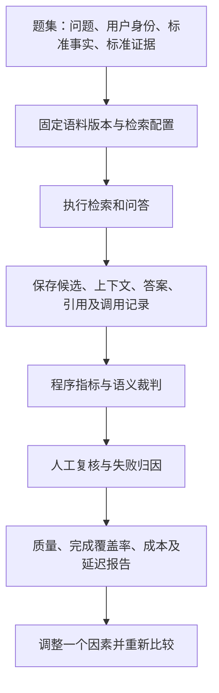

# RAG 项目评估完整说明：方法、指标、执行流程与当前实现

本文回答四个问题：RAG 要评估什么、怎样准备评估数据、怎样运行并解释结果、如何用结果指导优化。

适合先理解整体方法，再阅读本项目源码的开发者。文中同时说明通用实践和当前项目实现，二者分别标注。

若要先理解上传、解析、检索、普通 RAG 和 Agent 如何串起来，请从[项目源码导读](source-walkthrough.md)开始，再回到本文学习评估。

**实现核对基线：2026-10-08，`main` 分支，代码提交 `bc3d643`。** 本文依据当前 v2 评估实现与测试编写，不是一次真实模型实验报告；示例题目、数字和阈值均不代表项目实测成绩。当前技术栈为 Python FastAPI、MySQL、Milvus 和 LiteLLM；旧设计中的 Java、Elasticsearch 描述不能直接当作当前部署说明。

## 目录

1. [先理解评估在做什么](#1-先理解评估在做什么)
2. [构建评估题集与金标准](#2-构建评估题集与金标准)
3. [检索指标怎么计算](#3-检索指标怎么计算)
4. [回答质量怎么判断](#4-回答质量怎么判断)
5. [性能、成本与安全怎么评估](#5-性能成本与安全怎么评估)
6. [本项目的真实执行链](#6-本项目的真实执行链)
7. [从零完成一轮评估](#7-从零完成一轮评估)
8. [怎样阅读报告与设置门禁](#8-怎样阅读报告与设置门禁)
9. [怎样做消融与配对比较](#9-怎样做消融与配对比较)
10. [失败诊断与优化顺序](#10-失败诊断与优化顺序)
11. [Agentic RAG 与线上持续评估](#11-agentic-rag-与线上持续评估)
12. [当前能力边界与交付检查](#12-当前能力边界与交付检查)
13. [源码与文档阅读入口](#13-源码与文档阅读入口)

## 1. 先理解评估在做什么

**RAG 评估就是：用一批有明确判定依据的问题，检查系统有没有找到证据、有没有正确使用证据、是否以可接受的成本完成任务。**

评估对象是完整系统，包括语料、解析、切块、索引、权限过滤、检索、重排、上下文组装、模型及提示词。换一个模型只是改变其中一个环节。



这是推荐的完整评估闭环，图中的所有中间记录不意味着当前项目已经逐项实现。

可以把评估分成三层：

| 层次 | 核心问题 | 例子 |
| --- | --- | --- |
| 检索评估 | 需要的资料有没有找全、排前？ | 三条必需证据只找到一条 |
| 回答评估 | 答案是否正确、完整、有依据？ | 证据写 3 次，答案却写 5 次 |
| 系统评估 | 权限、可靠性、速度、成本是否合格？ | 回答正确，但引用了用户无权查看的文档 |

三者不能互相替代。检索分高不保证回答好，回答好也不能抵消权限泄漏。

## 2. 构建评估题集与金标准

### 2.1 一道题需要哪些内容

只有“问题 + 参考答案”通常不够。为了诊断检索问题，还需要标准证据和适用条件。

| 内容 | 用途 | 本项目字段 |
| --- | --- | --- |
| 唯一题号 | 对齐不同实验中的同一道题 | `caseKey` |
| 问题组 | 把近重复题和同会话问题放在一起 | `groupKey` |
| 数据分区 | 分开调参与最终测试 | `split: DEV / TEST` |
| 类别 | 查看各类题的表现 | `category` |
| 问题 | 用户实际输入 | `question.text`，另支持存储 `turns` |
| 用户身份 | 定义该用户能看什么资料 | `persona.loginName` |
| 预期行为 | 应回答、部分回答、拒答还是指出冲突 | `expected.status` |
| 必需事实 | 定义答案要覆盖哪些要点 | `expected.factPoints` |
| 证据组 | 定义每个要点的可接受原文来源 | `expected.evidenceGroups` |
| 标注状态 | 区分草稿、自动核查与人工审核 | `annotationStatus` |

下面是符合本项目字段形状的教学示例。内容为虚构，ID 是占位符；导入前必须替换成实际入库记录，并保证引文能在指定版本中定位。

```json
{
  "caseKey": "retry-001",
  "groupKey": "order-retry-policy",
  "split": "DEV",
  "category": "MULTI_EVIDENCE",
  "question": {"text": "订单重试前需要检查哪些事项？"},
  "persona": {"loginName": "operator"},
  "expected": {
    "status": "ANSWER",
    "factPoints": ["检查幂等键", "检查重试次数上限", "检查补偿日志"],
    "evidenceGroups": [
      {
        "fact": "检查幂等键",
        "alternatives": [{
          "documentId": "<实际文档ID>",
          "versionId": "<实际版本ID>",
          "quote": "订单重试前必须检查幂等键。",
          "relevanceGrade": 3
        }]
      },
      {
        "fact": "检查重试次数上限",
        "alternatives": [{
          "documentId": "<实际文档ID>",
          "versionId": "<实际版本ID>",
          "quote": "重试前应确认尚未达到重试次数上限。",
          "relevanceGrade": 3
        }]
      },
      {
        "fact": "检查补偿日志",
        "alternatives": [{
          "documentId": "<实际文档ID>",
          "versionId": "<实际版本ID>",
          "quote": "重试前需核对补偿日志，避免重复补偿。",
          "relevanceGrade": 3
        }]
      }
    ]
  },
  "annotationStatus": "DRAFT"
}
```

**不同证据组表示不同的必需事实；同组的多个 `alternatives` 表示可替代的证据。** 同组命中一个来源即可，不必把所有替代文档全部检索出来。标准答案允许措辞变化，但事实、条件和结论必须一致。

`factPoints` 与证据组要相互对应。当前 LLM 裁判优先读取非空 `factPoints`，否则取证据组中的 `fact`；漏写事实会让评分标准本身不完整。

### 2.2 题目从哪里来

建议混合使用真实用户问题、业务人员整理的问题、历史失败案例和人工核查后的合成问题。

模型生成题目适合补充初稿，不能自动变成金标准。至少检查：问题是否自然、参考答案是否完整、证据是否支持、版本是否有效、用户是否有权查看。

覆盖以下类型：

| 类型 | 主要检验什么 |
| --- | --- |
| 精确事实与标识符 | 数字、错误码、接口名、配置名是否检索准确 |
| 同义改写 | 用户措辞不同于原文时能否找到证据 |
| 条件与多证据 | 是否遗漏适用条件或必要事实 |
| 多跳问题 | 是否能组合多处证据 |
| 追问 | 是否结合前文补全问题 |
| 无答案 | 是否避免编造并合理拒答 |
| 冲突与旧版 | 是否识别冲突、使用正确版本 |
| 权限反例 | 是否隔离跨租户、撤权和不可见文档 |
| 表格与 OCR | 解析是否保留数值、列关系和上下文 |

起步可以先准备约 30 道代表性题目，用来验证流程和暴露明显问题。它不能证明整个业务场景都达到某个准确率。规模应随问题复杂度、类别覆盖和风险增长，不能只追求题目数量。

### 2.3 怎样避免测试集泄漏

DEV 用于反复调参，TEST 用于预先约定的最终比较。近重复问题和同一会话的追问按 `groupKey` 分组，不能分散到两个分区。

题集冻结后不覆盖旧标准。发现标注错误时复制为新版本、修正并记录原因。若反复看 TEST 结果来调参，这份 TEST 就已经受到调参影响，应准备新的独立题目。

本项目冻结会检查：非空题集、无 DRAFT 题、同组不跨分区、可答题具有证据组、每个引文能在指定文档版本的 `source_unit` 中找到。`AUTO_REVIEWED` 可以通过状态检查，但不等于人工审核完成；接口冻结成功也不是金标准质量认证。

## 3. 检索指标怎么计算

### 3.1 先确定“命中”的定义

不能只看检索结果中是否出现相同文字。例如旧制度和新制度可能包含同样的句子，但只有指定版本才符合本题条件。

当前实现要求同时满足：

1. `documentId` 与标准锚点一致。
2. `versionId` 与标准锚点一致。
3. 标准 `quote` 是候选文本的子串。

有 `chunkId` 时优先从数据库查回对应文本和来源，否则使用命中项中的来源字段。缺来源、错版本不算命中。这是确定性的原文匹配，不能代替语义判断；长引文跨 chunk、OCR 差异和文本规范化都可能造成匹配失败。

### 3.2 用一个例子理解 Hit、Recall 和 MRR

假设问题需要 A、B、C 三个事实组，Top5 结果如下：

| 排名 | 命中的事实组 |
| --- | --- |
| 1 | 无 |
| 2 | A |
| 3 | A 的另一份重复证据 |
| 4 | C |
| 5 | 无 |

则：

- **Hit@5 = 1**：至少命中一个必需事实组。
- **Recall@5 = 2/3**：三个组覆盖了 A 和 C，重复的 A 不增加覆盖。
- **MRR@5 = 1/2**：首个有效证据排第 2。

数据集级别通常先计算每题得分，再取宏平均。因此不能把 Hit@5=100% 理解成证据找全：每题只找出一个事实组也可能达到 100%。

本项目固定 `k=5`。报告字段叫 `mrr`，但当前实际计算的是前 5 条范围内的倒数排名；前 5 条未命中记 0。没有标准事实组的题，正常计算返回 `null`，而非自动获得满分。

### 3.3 nDCG 衡量什么

nDCG 适合评价具有相关性等级的排序：高价值证据越靠前，分数越高。

```text
gain(grade) = 2^grade - 1
DCG@K = Σ gain(grade_i) / log2(i + 1)   （i 从 1 开始）
nDCG@K = DCG@K / IDCG@K
```

`IDCG` 是同一评价口径下的理想排序得分；为 0 时指标不可用。项目等级范围为 0..3。

**当前实现的特殊口径：** 理想序列取每个事实组的最高等级；每条候选取其新覆盖事实组的最高等级，已经在前面覆盖过的组不再贡献增益。这是一种基于金标准事实组构造的评分，不能直接当成“所有候选都经过完整人工分级”的标准候选池 nDCG，也不宜与其他工具未经对齐的 nDCG 横向比较。

### 3.4 检索结果与最终上下文要分开看

理想情况下分别评估召回候选、重排后候选和实际送入模型的上下文：

```text
召回阶段找到 A、B、C
→ 重排后保留 A、B
→ 上下文截断后只剩 A
→ 模型无法完整回答
```

可增加 `Context coverage = 实际上下文覆盖的必需事实组数 / 必需组总数`。

当前 `_compute_retrieval_metrics()` 没有独立使用传入的 `evidence_list` 计算上下文覆盖。检索模式传入流水线 `hits`，RAG/AGENT 模式传入最终 QA `evidence`。虽然指标标注了 `FINAL_RANKED_CANONICAL`，仍应根据调用来源解释它，不能据此声称已经完成各阶段召回和上下文覆盖评估。

**PR #13 普通 RAG 检索图的评估边界**：普通 RAG（包括 `mode=RAG` 的批量评估）现通过 `RagRetrievalGraph` 执行检索节点；纯检索模式 `RETRIEVAL_ONLY` / `RETRIEVAL_PIPELINE` 和 Agent 的 `search_knowledge` 仍使用 `RetrievalPipeline.retrieve()`。普通 RAG 检索节点新增 `RAG_DENSE_RECALL`、`RAG_BM25_RECALL`、`RAG_RRF_FUSION`、`RAG_RERANK`、`RAG_CONTEXT_BUDGET` 等 `run_event`，**当前只记录阶段命中数量、耗时和开关，不保存完整有序候选列表，也不自动计算阶段级 Recall@5、NDCG@5 或 Context Coverage**。需在权限受控的评估执行中另行保存各阶段 canonical Chunk ID / Build ID 及排名，才能将阶段数据与 Gold fact groups 对齐计算归因指标。详见 [普通 RAG LangGraph 检索图说明](rag-langgraph-retrieval.md)。

## 4. 回答质量怎么判断

### 4.1 四个维度不要混为一谈

| 维度 | 判定问题 | 典型失败 |
| --- | --- | --- |
| 正确性 | 结论、事实、条件是否符合金标准？ | 重试上限写错 |
| 完整性 | 必需事实是否全部回答？ | 漏掉补偿日志检查 |
| 忠实性 | 每个回答断言是否得到提供证据支持？ | 添加原文没有的限制 |
| 引用质量 | 引用是否真的支持对应断言？ | 引用了相关文档，但引用段落不能证明结论 |

忠实但不正确：严格照着过期制度回答。正确但缺少依据：模型凭自身知识碰巧答对。文档存在或引用格式合法，都不能证明其语义支持答案。

### 4.2 三种评分手段如何配合

程序规则适合来源 ID、状态、格式、明确数值和检索命中；LLM 裁判适合语义覆盖与证据支持；人工负责业务难题、边界案例和裁判校准。

LLM 评审应输入问题、必需事实、实际断言和引用证据，并输出逐项标签及简短理由。材料应作为不可信数据处理，不能执行答案或文档中夹带的“请给满分”等指令。

裁判也可能误判。正式依赖前，应准备人工复核集，观察裁判把错误答案判为正确的比例、各类题的一致性，以及不同版本裁判的变化。固定模型、规则和版本便于比较，不能把裁判标签直接称为人工金标准。

### 4.3 当前 HUMAN 与 LLM 模式

`judgeMode` 默认是 `HUMAN`，不是默认调用 LLM。

首先检查预期与实际终态的对应关系：

| 预期 `expected.status` | 当前要求的 QA 终态 |
| --- | --- |
| `ANSWER` | `COMPLETED` |
| `PARTIAL` | `PARTIAL` |
| `ABSTAIN` | `NO_EVIDENCE` |
| `CONFLICT` | `CONFLICT` |

终态不匹配判为 `WRONG`；匹配时只是具备继续评估语义的条件。HUMAN 模式保留 `UNDETERMINED`，等待人工复核。

新运行在状态检查通过后调用 `judge-main`，使用 `full-answer-and-relevance-v2`。输入不再只有 claims/evidence，而是同时包含用户实际看到的 `answerText`、最后问题、真实多轮 `conversationContext`、题型 expectation、标准事实、claims 与 evidence。评分范围固定为 `FINAL_TURN_WITH_HISTORY`：历史用于理解指代和约束，只评分最后一轮回答。

v2 一次调用同时返回：

- 每个标准事实：`COVERED / MISSING / CONTRADICTED / UNCERTAIN`。
- 每个回答断言：`SUPPORTED / UNSUPPORTED / UNCERTAIN`。
- `answerRelevance`：`ON_TOPIC / PARTLY_OFF_TOPIC / OFF_TOPIC / UNCERTAIN`。
- `claimAlignment`：`ALIGNED / MISMATCH / UNCERTAIN`，用于检查正文与 claims 双向一致。
- `expectationAssessment`：`SATISFIED / VIOLATED / UNCERTAIN`，按 ANSWER / PARTIAL / ABSTAIN / CONFLICT 的 Gold 规则判断。

Relevancy 是 **OBSERVE_ONLY**：它独立展示，不会因为“切题”而抬高 correctness，也不会因为“偏题”直接覆盖已有事实证据。正文与 claims 不一致时，如果没有足够证据证明业务答案本身错误，综合结果保持 `UNDETERMINED` 并进入人工复核；已有明确矛盾、无依据断言或题型违反仍判 `WRONG`。拒答没有事实性 claims 时 `faithfulness=null`，不会伪造满分。

缺失正文与空白正文分开处理：字段缺失表示无法完整评估，记 `UNDETERMINED / MISSING_ANSWER_TEXT`；确实输出空白且任务要求回应时记失败。输入超过 Judge 上限时记 `UNDETERMINED / INPUT_TOO_LARGE`，不会静默截断后冒充完整评估。

旧运行继续依据其 manifest 中的 `rubricVersion=fact-and-support-v1` 走 v1 兼容路径；新运行写入 `inputContractVersion=full-answer-v2`、`evaluationScope=FINAL_TURN_WITH_HISTORY` 与 `relevancePolicy=OBSERVE_ONLY`。不同 rubric / 输入契约不应作为同条件实验直接比较。

### 4.4 人工复核怎么保留历史

本项目通过 `eval_review` 追加复核记录，不覆盖原自动结果。汇总使用每道结果的最新复核标签。

建议复核理由至少包括：哪一项事实错误或遗漏、依据哪段证据、为何修正标签。复核为 `PARTIAL` 或 `WRONG` 的题，在严格成功率中都不算成功；复核为 `UNDETERMINED` 仍属于未判定。

## 5. 性能、成本与安全怎么评估

### 5.1 性能

同时看 P50、P95、失败率和超时数；平均延迟会掩盖慢请求。P95 可以理解为约 95% 的已观察样本耗时不超过该值。

当前项目使用 nearest-rank 百分位：排序后取 `ceil(N × q) - 1` 的下标，输出 `observedP50Ms` 和 `observedP95Ms`。样本很少时，P95 可能就是最大值。

当前 RAG 的 `durationMs` 在 QA 等待结束后、LLM 裁判之前计算，不包含整轮评估管理开销和裁判耗时。超时记录只表示已等待多久，不代表请求最终完成时间。若要评估整条评估流水线的成本与速度，需要另行记录总耗时。

### 5.2 成本

建议统计检索改写、Embedding、Reranker、生成、语义验证、裁判和重试的全部调用，并区分真实结算、估算和未知。

当前项目读取与 QA run 关联的 `model_call` 结算记录，排除 `pricing_snapshot.rate == "fixed"` 的占位价格：

- `knownCostCny`：已经能够确认的费用部分。
- `unknownCostCases`：存在未知费用的结果数量。
- `totalCostCny`：仅所有结果费用已知时给出数值，否则为 `null`。
- 无模型 BM25 的 `RETRIEVAL_ONLY` 可明确记为 0。
- `RETRIEVAL_PIPELINE` 当前调用归属未完整接入，费用保留未知。

不能把 `null` 当作 0，也不能用已知部分冒充总费用。启动估算使用静态公式，即便接口标记为 `UPPER_BOUND`，也不能据此保证供应商实际账单绝不超限。当前预算参数大于 0 且不超过 10 CNY；大题集可能在启动前因估算超限被拒绝，应先用小规模核查集验证流程。

### 5.3 权限与系统可靠性

业务质量题集之外，还需要确定性的权限与故障测试，例如跨租户查询、撤权后引用访问、旧版本禁读、导出权限、模型超时和任务恢复。

评估管理员能够管理实验，不意味着被测用户也应具有管理员权限。还要验证实验确实使用题目指定的身份和资料范围。安全反例不能仅靠“几个正常问答题都通过”来覆盖。

## 6. 本项目的真实执行链

### 6.1 四种运行模式

| 模式 | 做什么 | 能否评回答质量 |
| --- | --- | --- |
| `RETRIEVAL_ONLY` | 仅无模型 BM25；拒绝需要模型的检索配置 | 不能 |
| `RETRIEVAL_PIPELINE` | 检索流水线，可包含 Dense、Hybrid、重排等 | 不能 |
| `RAG` | 调用真实 QA 服务执行普通 RAG | 可以，但需要质量判定 |
| `AGENT` | 调用真实 QA 服务执行 Agent 问答 | 可以，还需看轨迹与额外成本 |

检索模式的 `judge.correctness` 为 `NOT_EVALUATED`。其 `taskSuccess` 对非拒答题主要表示是否命中证据，不能与 RAG 的语义成功率混用。

### 6.2 从 API 追到执行与评分

API 前缀为 `/api/v1/admin/eval`。

```text
router.py
  → EvaluationCatalog：创建题集、保存题目、冻结、建立快照
  → EvaluationRunner.estimate：检查冻结状态、快照、已发布配置和预算估算
  → EvaluationRunner.start：写 eval_run、EVALUATE job、全部 PENDING 结果
  → DurableJobWorker 执行 EVALUATE
  → EvaluationRunner._execute_run
      ├─ RETRIEVAL_* → _persona() → RetrievalPipeline.retrieve（快照文档范围）
      └─ RAG / AGENT → _persona() → _run_qa_turns（同一会话逐轮 QA，传入 evaluation_scope）
  → _compute_retrieval_metrics + 状态检查 + 可选 judge_answer
  → _update_result：持久化单题结果
  → aggregate：应用最新人工复核并汇总
  → export_run / compare：导出或比较
```

测试环境部分入口同步执行以便确定性测试；非测试环境的评估主任务交给持久化 `EVALUATE` Worker。**评估 RAG 即使 `mode=RAG`，因携带 `evaluation_scope`，仍会创建 `QA_RUN` Job 并由 QA Worker 执行**，不同于浏览器普通 RAG 的 BackgroundTasks 路径。这让批量评估能够按持久化任务恢复、重试。请求中应使用稳定的 `Idempotency-Key`，在同一启动请求因网络原因重试时复用；改了请求内容则使用新键。

预建全部 PENDING 结果的意义是：未开始的题也不会从计划总数中消失。执行完毕、回答正确和可发布，是三个不同层次的判断。

### 6.3 哪些快照确实被记录

题集冻结记录内容 hash。语料快照记录文档、版本、当前 build、来源 hash、构建配置、环境和权限 epoch。估算阶段会核对当前 build 和权限 epoch 是否变化。

运行 manifest 包含题集版本、快照 ID、检索配置及载荷、分区、重复次数、模式、严格模式、裁判模式、规则版本、预算和环境等。

检索模式把快照文档 ID 作为 `document_ids`；RAG/AGENT 将 `evaluation_scope` 持久化到 QA 运行，检索及章节读取通过 `run_document_scope()` 限定快照文档与 Build。执行期间反复检查权限 epoch、文档状态和生效 Build，变化时失败关闭。这是范围限制与变化检测，不是把语料和权限物理锁住；模型供应商版本、全部提示词和运行时依赖也未因此固化。完整实验仍应记录代码提交、部署版本和真实模型配置。

## 7. 从零完成一轮评估

### 7.1 先满足运行前提

1. 在隔离评估环境启动当前 Python 后端、Worker、MySQL、Milvus 和所需模型服务。
2. 使用模拟或已确认脱敏资料，完成入库并确认 active build 可用。
3. 确认被测 `persona.loginName` 存在，且权限符合用例设计。
4. 创建并发布所需 RETRIEVAL 配置；模型别名、向量维度与索引一致。
5. 用少量人工核查过的题先验证全过程；不要直接把自动生成的 300 条当作已审核题集。

本节是 API 操作说明，不会自动发起模型调用。实际请求须带现有登录会话以及写接口要求的 CSRF 信息，不应把密码或密钥放进报告或 Git。

### 7.2 按顺序调用 API

以下路径均相对于 `/api/v1/admin/eval`：

| 顺序 | 方法与路径 | 操作目的 |
| --- | --- | --- |
| 1 | `POST /datasets` | 创建题集版本 |
| 2 | `POST /dataset-versions/{versionId}/cases` | 保存实际绑定后的题目，批量体为 `{"cases": [...]}` |
| 3 | `GET /dataset-versions/{versionId}/cases` | 复查导入内容和标注状态 |
| 4 | `POST /dataset-versions/{versionId}/freeze` | 校验并冻结 |
| 5 | `POST /snapshots` | 为选定文档建立快照 |
| 6 | `POST /estimates` | 校验运行条件并估算费用 |
| 7 | `POST /runs` | 使用相同参数启动运行 |
| 8 | `GET /runs/{id}` 和 `GET /runs/{id}/results` | 查看总状态与逐题结果 |
| 9 | `POST /results/{id}/reviews` | 追加人工复核 |
| 10 | `POST /runs/{id}/exports` | 导出重新汇总后的报告 |

创建快照的请求示例：

```json
{
  "name": "retry-policy-eval-v1",
  "documentIds": ["<实际文档ID>"],
  "approvedSyntheticOrRedacted": true
}
```

只有资料实际满足模拟或已脱敏条件时才填写 `true`。

估算请求示例：

```json
{
  "datasetVersionId": "<冻结题集版本ID>",
  "snapshotId": "<快照ID>",
  "configId": "<已发布检索配置ID>",
  "split": "DEV",
  "mode": "RAG",
  "judgeMode": "LLM",
  "strict": false,
  "repeats": 1
}
```

将这些字段原样用于启动请求，并增加返回的 `estimateId` 与 `maxCostCny`。`repeats` 当前允许 1..3。`judgeMode` 必须显式选择；省略就进入 HUMAN 模式。

人工复核请求示例：

```json
{
  "labels": {"correctness": "PARTIAL"},
  "reason": "已回答幂等键和重试次数，但遗漏标准证据要求的补偿日志检查。"
}
```

导出请求使用 `{"mode":"REDACTED"}`。当前接口直接返回报告 JSON，不是下载链接；将响应保存为本地 `report.json`。报告可能包含内部 ID 与配置，仍需按资料敏感程度决定存放范围。

### 7.3 本地验证与质量门禁

以下命令从仓库根目录使用 Windows 原生 PowerShell 执行，前提是 `backend/.venv` 已按后端说明安装依赖。

检查评估相关代码回归：

```powershell
Push-Location -LiteralPath .\backend
try {
    & .\.venv\Scripts\python.exe -m pytest tests/test_evaluation.py tests/test_evaluation_quality.py -q
    if ($LASTEXITCODE -ne 0) { throw '评估回归测试失败' }
} finally {
    Pop-Location
}
```

对单次运行的导出报告执行回答质量门禁：

```powershell
& .\backend\.venv\Scripts\python.exe .\scripts\check_evaluation_gate.py .\report.json --min-success 0.9 --max-cost 10
if ($LASTEXITCODE -ne 0) { throw '评估报告未通过质量门禁' }
```

`0.9` 与 `10` 只是示例，应由业务验收标准确定。单元测试验证程序逻辑，不证明真实模型准确率；质量门禁检查报告字段，不等于完整的安全、性能和部署验收。

## 8. 怎样阅读报告与设置门禁

### 8.1 成功率必须同时看分母

当前汇总同时给出“已判定子集”和“全计划”两种口径：

```text
taskSuccessRate = successful / judged
plannedTaskSuccessRate = successful / planned
judgmentCoverage = judged / planned
completionCoverage = completed / planned
```

其中 `executionFailed`、`pending` 是执行轴；`unknown` 是语义判定轴。两类计数不能直接相加解释成同一种失败。

这里“结果数”包括重复运行。例如 20 道题、每道重复 3 次，计划结果为 60，不是 20 个独立问题。

教学例子：100 个计划结果全部执行完，只有 20 个完成质量判定，其中 18 个正确：

```text
completed = 100
planned = 100
judgedCases = 20
taskSuccessRate = 90%
judgmentCoverage = 20%
已确认成功数 / 计划数 = 18%
```

90% 只描述已判定子集，不能声称整个系统在 100 道题上有 90% 成功率。18% 表示当前已确认的成功占比，也不能把剩下 80 个未知结果全部解释为已证实错误。

因此 API 保留兼容字段 `taskSuccessRate`，同时新增 `plannedTaskSuccessRate`。界面会明确标注前者是“已判定样本成功率”，后者才是“成功数 / 全计划数”。

### 8.2 其他字段的读法

| 字段 | 正确理解 |
| --- | --- |
| `completed` | 单题评估执行完成，不表示答案正确 |
| `failed` / `notCompleted` | 执行失败和其他未完成结果，不能隐藏 |
| `humanReviewedCases` | 有人工复核记录的结果数；复核仍可是不确定 |
| `retrievalDenominator` | 实际进入检索宏平均的结果数 |
| `ndcgDenominator` | 实际进入 nDCG 平均的结果数 |
| `totalCostCny: null` | 总费用未知，不是免费 |
| `observedP95Ms` | 已记录耗时的 P95，受样本量、失败和超时影响 |

当前汇总只对有数值的检索指标取平均；部分异常路径会写入 0，PENDING 则没有数值。它不是无条件按所有计划题取平均，尤其要留意无证据题、失败题与未运行题的分母差异。

### 8.3 当前门禁实际检查什么

`check_evaluation_gate.py` 要求：

1. 计划数非零，且 `completed == planned`。
2. `judgmentCoverage == 1`。
3. `taskSuccessRate` 为有限数值且达到阈值。
4. `totalCostCny` 为有限、非负数值且不超过上限。
5. manifest 模式为 `RAG` 或 `AGENT`。

纯检索报告、未知费用、未完成评估、未完全判定都不能通过。脚本返回非零退出码时应阻断该门禁。

门禁没有同时验证所有权限反例、P95 阈值、裁判校准或模型部署快照；这些仍需独立验收。也不要把多实验打包报告直接传给脚本，它需要的是具有顶层 `manifest` 和 `metrics` 的单次运行导出。

## 9. 怎样做消融与配对比较

### 9.1 先做 B0–B3

| 实验 | 变化项 | 要回答的问题 |
| --- | --- | --- |
| B0 | BM25 | 关键词检索基线是什么水平？ |
| B1 | Dense | 语义检索在哪些题上改善或退步？ |
| B2 | Hybrid + RRF | 两路融合是否提高覆盖？ |
| B3 | Hybrid + RRF + Reranker | 在 B2 上增加重排是否值得？ |

固定题集、语料快照、用户身份、生成模型、提示词、上下文预算、裁判及其他查询开关，再改变目标因素。B2 与 B3 才是较明确的“重排开关”比较；B0 与 B3 同时变化多个环节，不能把差异全部归因于重排。

本项目配置位于 [retrieval-ablation.json](../experiments/retrieval-ablation.json)。完成基础比较后，再单独考察 Rewrite、HyDE、Multi-Query、父段扩展或不同切块，不要一开始就全部打开。

### 9.2 配对比较比只看均值更有用

逐题对齐 `caseKey` 和重复编号，至少统计：双方都对、双方都错、原来错现在对、原来对现在错。后两项揭示收益和回归。

报告各类别的样本数和结果，不要让大量简单题掩盖少量关键题。小幅提升可能来自随机波动；可做有限重复并报告波动范围，进一步使用按问题或问题组重采样的配对置信区间。重复运行结果相关，不能把它们全部当成独立新增题目。

这些统计分析属于推荐实践，当前 `compare()` 主要检查 manifest 一致性并返回运行与逐题结果，没有自动给出统计显著性结论。

### 9.3 当前比较接口与脚本的限制

`GET /comparisons?runIds=<id1>,<id2>` 接受 2..4 次运行。比较字段包括题集版本、快照、分区、模式、strict、repeats、环境、judgeMode 和 rubricVersion。

RAG 与 AGENT 模式不同，会被当前接口标为不可直接比较。要研究 Agent 的价值，应设计单独的跨模式实验，手动核对共同条件，不能宣称现有接口已认定二者可比。

`Run-RetrievalAblation.ps1` 当前启动 `mode=RAG`，但没有显式发送 `judgeMode=LLM`，因此按当前后端默认进入 HUMAN 模式。旧运行手册中的“自动 LLM 裁判”描述不能直接套用。脚本完成也不代表回答质量门禁通过。

可先只检查配置矩阵，下面命令不会启动模型评估：

```powershell
& .\scripts\Run-RetrievalAblation.ps1 -SelfTest
```

真实运行前，应先解决裁判模式、费用对账、题集质量和运行范围问题。本说明文档不修改现有脚本行为。

## 10. 失败诊断与优化顺序

不要看到答案错了就直接换模型。先沿着数据流找第一个出错的阶段。

| 观察到的现象 | 优先检查 | 合理的下一步 |
| --- | --- | --- |
| 原始资料里没有答案 | 语料覆盖 | 补资料，或将问题定义为应拒答 |
| 原始文件有答案，解析结果没有 | OCR、表格、解析器 | 修复解析并重建索引 |
| 标准引文无法定位 | 金标准版本与锚点 | 修订标注，新建题集版本 |
| 正确证据不在召回候选中 | 切块、查询、过滤、检索路线 | 在 DEV 做定向检索实验 |
| 候选有证据，重排后丢失 | 重排与候选上限 | 对比开关及排名变化 |
| 重排保留，最终上下文丢失 | 上下文预算、截断、父段扩展 | 检查实际模型输入 |
| 证据完整，但回答错误 | 提示词、模型推理、冲突处理 | 先固定证据评估生成能力 |
| 答案对，引用不支持 | claim 与引用映射 | 复核关联，而非只检查链接存在 |
| 大量题拒答 | 阈值、检索、权限 | 同时看正确拒答与可答题错误拒答 |
| 质量提高但 P95/成本明显变差 | 调用次数、重排、Agent 循环 | 判断业务收益是否值得代价 |

可给失败案例加多个归因标签：`corpus_missing`、`parse_error`、`anchor_error`、`retrieval_miss`、`rerank_drop`、`context_drop`、`generation_error`、`citation_error`、`permission`、`provider_failure`、`budget`。

为了区分检索与生成问题，可以做一个诊断实验：直接把人工确认的正确证据交给生成模块。如果这样仍然答错，应优先处理生成；如果这样答对而完整 RAG 答错，就继续检查检索和上下文链路。这个实验提供故障定位证据，不能代替真实端到端结果。

## 11. Agentic RAG 与线上持续评估

### 11.1 Agentic RAG 额外评估什么

Agent 可以决定检索什么、是否继续搜索、何时停止。多轮检索不是固定必选步骤，也不意味着效果一定更好。

除最终回答外，应检查：

- 新的一次检索是否补上了缺失事实。
- 是否重复相同查询而没有新增证据。
- 简单问题是否花费过多调用。
- 是否及时停止、超时，或不必要地等待人工审批。
- 工具失败后是否正确处理，是否保留有效证据。

当前报告包含 `avgAgentTurns`、`avgAgentToolCalls`、`avgAgentTokens`、`agentTimeoutRate` 等轨迹摘要。它们用于解释代价，不能仅凭轮数较多就判断推理更深入。尤其不要把模型调用数直接等同于用户对话轮数。

当前 RAG / AGENT 评估会按 `question.turns` 逐轮提交真实 QA，并复用同一 conversation。v2 Judge 从实际持久化的 qa_run 中重建“用户问题 + 历史助手回答”，最后助手回答单独作为 `answerText` 评分，因此不会用测试题文本伪造历史。报告仍只评分最后一轮，不能把它解释成逐轮会话质量分。

### 11.2 上线后怎样形成闭环

推荐流程为：真实请求抽样 → 脱敏和权限核查 → 人工确认错误与归因 → DEV 回归题集 → 修复 → 独立 TEST 验收 → 观察线上变化。

点赞、点踩、重新提问和转人工可以帮助筛选案例，但不是准确的正确性标签。点踩可能来自慢、风格不合适或答案不完整；未点踩也不表示答案正确。

线上比较应记录配置版本、资料更新时间和流量差异。当前仓库的评估框架不等于已经建立完整的线上反馈回流与持续验收闭环。

## 12. 当前能力边界与交付检查

### 12.1 当前实现与仍需验证的部分

| 范围 | 当前可确认的实现 | 尚不能据此声称 |
| --- | --- | --- |
| 题集 | 版本、导入、标注状态、冻结、锚点校验 | 所有候选题均经业务人工审核 |
| 检索评分 | 文档+版本+引文匹配，Hit/Recall/MRR/nDCG | 全阶段上下文覆盖、完整候选池分级均已完成 |
| 回答评分 | 完整正文 v2 Judge、事实/支持、Relevancy、claim 对齐、题型判断、人工复核 | 裁判已在真实业务金标准上充分校准 |
| 费用 | 区分已知和未知费用，排除 fixed 占位价 | 已完成供应商账单对账与绝对硬预算保证 |
| 快照 | 检索/QA 限定快照文档与 Build，执行中检查权限及版本变化 | 语料与权限被物理锁住，或模型与依赖版本已完全固化 |
| 身份 | 检索、RAG、AGENT 统一使用有效 persona 的非管理员 Actor；缺失或停用返回 PERSONA_UNAVAILABLE | 所有题目的人设及权限已完成业务审核 |
| 多轮 | RAG/AGENT 在同一会话逐轮执行 turns，只评分最后一轮；检索模式拒绝多轮题 | 每一轮均有独立质量评分 |
| 比较 | 校验部分 manifest 字段并返回逐题结果 | 已自动完成显著性检验或跨模式可比性判断 |
| 门禁 | 检查完成、判定覆盖、成功率、总费用与模式 | 全部安全、性能、部署要求均已验收 |

执行身份、快照范围与多轮行为可沿以下源码核对：

1. [runner.py](../backend/app/evaluation/runner.py) 的 `_persona()` 为所有模式查找同租户的 ACTIVE 用户；不存在或停用时返回 `PERSONA_UNAVAILABLE`，不再退回发起者。检索与 QA 使用该非管理员 Actor，快照可用性检查仍由发起者执行。
2. `_run_qa_turns()` 按 `question.turns` 逐轮调用真实 QA，复用同一 conversation，并传入快照范围与可信配置。检索模式拒绝多轮题，不会只运行第一轮冒充完整会话。
3. [context.py](../backend/app/qa/context.py) 的 `run_document_scope()` 核对快照文档仍为 LIVE 且生效 Build 未变；普通检索和 Agent 章节读取应用该范围，外发前还复核来源。变化时中止，不自动切到新资料继续同一实验。

这些是当前源码已实现的约束，本次仅同步文档；真实依赖、并发变化与恢复行为仍需要隔离环境的端到端证据。

### 12.2 一轮评估应交付什么

- 可追溯的题集版本、分区、类别数量和标注说明。
- 语料快照、检索配置、代码提交及模型/裁判版本记录。
- 每题结果、预期行为、实际状态、证据、评分与错误原因。
- 完成数、失败数、未判定数，以及各指标的实际分母。
- 人工复核记录和裁判校准情况。
- 全部已知与未知费用、延迟及超时说明。
- 配对改善与退步案例，以及限制条件。
- 明确的结论：达到哪些条件、还有哪些条件未验证。

**可执行的最小起点：先用一小批审核过的问题，在固定资料与配置下跑通执行、逐题检查、人工复核和导出，再做单变量比较。** 先保证评估可信，后续增加题量和自动化才有意义。

## 13. 源码与文档阅读入口

以下链接指向仓库当前文件；具体行为可能随后续提交变化。

| 文件 | 阅读重点 |
| --- | --- |
| [evaluation/router.py](../backend/app/evaluation/router.py) | API 路径及参数入口 |
| [evaluation/catalog.py](../backend/app/evaluation/catalog.py) | 题集、冻结、锚点和快照校验 |
| [evaluation/runner.py](../backend/app/evaluation/runner.py) | estimate → start → execute → metrics → aggregate → export/compare |
| [evaluation/metrics.py](../backend/app/evaluation/metrics.py) | 检索公式、空分母和百分位 |
| [evaluation/judge.py](../backend/app/evaluation/judge.py) | 裁判规则与判定解析 |
| [test_evaluation.py](../backend/tests/test_evaluation.py) | 评估基础回归测试 |
| [test_evaluation_quality.py](../backend/tests/test_evaluation_quality.py) | 语义评分、版本命中、人工复核和门禁测试 |
| [check_evaluation_gate.py](../scripts/check_evaluation_gate.py) | 单次报告质量门禁 |
| [eval_smoke_30.jsonl](../datasets/eval_smoke_30.jsonl) | 题集字段参考；使用前需核查实际来源绑定 |
| [retrieval-ablation.json](../experiments/retrieval-ablation.json) | B0–B3 固定配置 |
| [Run-RetrievalAblation.ps1](../scripts/Run-RetrievalAblation.ps1) | 消融编排脚本；注意本说明列出的裁判默认值 |
| [评测可信度与验收](delivery/evaluation-quality-hardening.md) | 当前修正口径与剩余工作 |
| [评估系统与可复现实验设计](design/06-evaluation.md) | 更完整的设计目标；部分口径和技术栈已不同于当前实现 |
| [PRD-05](prd/PRD-05-evaluation-experiments.md) | 产品需求与验收目标，不等同于完成状态 |
