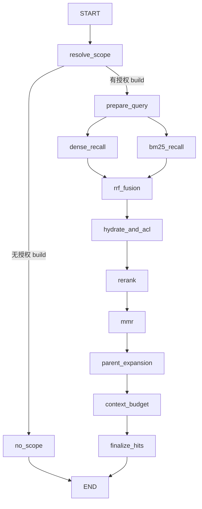

# 普通 RAG：LangGraph 检索 DAG

本次仅将 `mode=RAG` 的 **在线问答检索阶段**改成 LangGraph 编排。
生成答案、Claims/Judge 校验、最终事务、Agent 的 `model ↔ tools`、
独立 `/search` 和 `RetrievalPipeline.retrieve()` 的既有调用者暂不变。

## 编译后的 LangGraph 状态图（源码同步）

下面的图示对应 [`rag_graph.py`](../backend/app/retrieval/rag_graph.py) 中 `builder.compile()` 创建的普通 RAG 检索图。注意它不包含 `QaService` 内的答案生成或 Agent 的 `model/tools` 图。图的内容应以 `compiled.get_graph().draw_mermaid()` 的导出结果为准。

<!-- compiled-rag-retrieval-graph:begin -->

<!-- compiled-rag-retrieval-graph:end -->

**再生成（以编译结果覆盖图示）**：在 `backend/` 下运行 `python scripts/export_rag_retrieval_graph.py --write`。脚本真正调用 `RagRetrievalGraph._get_graph().get_graph().draw_mermaid()`，并替换上述图示；也可运行 `--print` 查看原生 Mermaid 或 `--check` 验证文档是否与编译图一致。无需访问 Milvus 或调用 LLM。

## 节点拓扑



- Dense / BM25 是两个并行分支；单模态配置下对应禁用路返回空列表。RRF 汇合点等待两路完成。
- 复用已有的查询改写、Milvus、RRF、reranker、MMR、Parent、provenance 逻辑，保持版本化配置、canonical chunk 去重和 fail-open 的原有语义。
- 沿用检索前、发送到 reranker 前、返回给 QA 前的 ACL / active build 检查。
- 新增 `RAG_SCOPE`、`RAG_PREPARE_QUERY`、`RAG_BM25_RECALL`、`RAG_DENSE_RECALL`、`RAG_RRF_FUSION`、`RAG_RERANK`、`RAG_MMR`、`RAG_PARENT_EXPANSION`、`RAG_CONTEXT_BUDGET`、`RAG_FINAL_HITS` 等 `run_event`，只保存数量/耗时/配置标记，不保存未选中的正文。
- 图不启用 Checkpointer，因此 **不承诺节点级故障恢复**；普通在线问答继续 `REALTIME + BackgroundTasks`，不会排队等待 Job Worker。
- 本次未改动 Agent `search_knowledge`、搜索 API 或评估流水线的底层调用；如后续需要对齐所有检索入口，应在经过行为基线对照后另行迁移。
- 当前只记录阶段计数和耗时，**尚未计算阶段级 Recall/NDCG**。真正做质量归因时，需要在权限受控的评估范围内保存各阶段有序的 canonical Chunk ID/Build ID，并和 Gold anchors 做比对。

代码：`backend/app/retrieval/rag_graph.py`；接入：`backend/app/qa/service.py`。

## 验证

```bash
cd backend
pytest -q tests/test_qa.py tests/test_retrieval.py tests/test_enterprise_retrieval.py tests/test_evaluation.py tests/test_agent_runtime.py
```

特别检查 `test_qa_run_lifecycle_and_evidence`：在线普通 RAG 的阶段事件与最终 Evidence 数量一致，并确保没有 `QA_RUN` Job。
