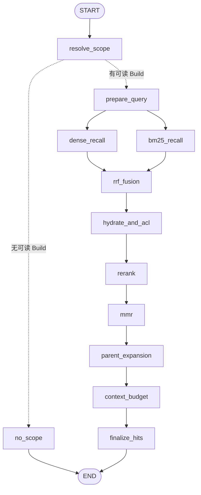
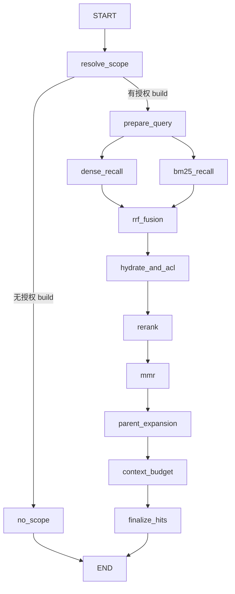

# Agent 知识检索工具：LangGraph 检索 DAG

**当前 `main`（PR #14 已合并）**：新在线问答统一进入 Durable LangGraph Agent。模型需要检索时，`search_knowledge` 调用本文的 `RagRetrievalGraph.retrieve()`；`read_section` 可单独读取文档；四个模拟业务工具不需要强制知识检索。检索图不生成答案，只返回受 ACL 保护的证据。独立 `/search` 和纯检索评测保留 `RetrievalPipeline.retrieve()`。旧 RAG 在线执行分支仍为待排空旧任务保留，不是新请求入口。

## 编译后的 LangGraph 状态图（源码同步）

下面的图示对应 [`rag_graph.py`](../backend/app/retrieval/rag_graph.py) 中 `builder.compile()` 创建的检索图。它位于外层 Agent 的工具调用内部，不包含 Agent `model/tools` 循环、证据/回答验证或历史运行流程。图的内容应以 `compiled.get_graph().draw_mermaid()` 的导出结果为准。

<!-- compiled-rag-retrieval-graph:begin -->

<!-- compiled-rag-retrieval-graph:end -->

**再生成（以编译结果覆盖图示）**：在 `backend/` 下运行 `python scripts/export_rag_retrieval_graph.py --write`。脚本真正调用 `RagRetrievalGraph._get_graph().get_graph().draw_mermaid()`，并替换上述图示；也可运行 `--print` 查看原生 Mermaid 或 `--check` 验证文档是否与编译图一致。无需访问 Milvus 或调用 LLM。

## 节点拓扑



- Dense / BM25 是两个并行分支；单模态配置下对应禁用路返回空列表。RRF 汇合点等待两路完成。
- 复用已有的查询改写、Milvus、RRF、reranker、MMR、Parent、provenance 逻辑，保持版本化配置、canonical chunk 去重和 fail-open 的原有语义。
- 沿用检索前、发送到 reranker 前、返回给 QA 前的 ACL / active build 检查。
- 新增 `RAG_SCOPE`、`RAG_PREPARE_QUERY`、`RAG_BM25_RECALL`、`RAG_DENSE_RECALL`、`RAG_RRF_FUSION`、`RAG_RERANK`、`RAG_MMR`、`RAG_PARENT_EXPANSION`、`RAG_CONTEXT_BUDGET`、`RAG_FINAL_HITS` 等 `run_event`，只保存数量/耗时/配置标记，不保存未选中的正文。
- 检索图不启用 Checkpointer，**不保证恢复其内部任意节点**；新问答由外层 Agent 的 Durable Job + checkpoint 保护节点边界，不能把两层恢复能力混为一谈。
- Agent 的 `search_knowledge` 已接入本图；独立 Search API 与 `RETRIEVAL_ONLY` / `RETRIEVAL_PIPELINE` 仍使用原 Pipeline。评估完整 QA 的新运行规范化为 Agent；旧评估 manifest 保留原含义。
- 当前只记录阶段计数和耗时，**尚未计算阶段级 Recall/NDCG**。真正做质量归因时，需要在权限受控的评估范围内保存各阶段有序的 canonical Chunk ID/Build ID，并和 Gold anchors 做比对。

代码：`backend/app/retrieval/rag_graph.py`；新调用入口：`backend/app/qa/agent.py::_tools_step()`；外层调度：`backend/app/qa/service.py`。

## 验证

```bash
cd backend
pytest -q tests/test_qa.py tests/test_retrieval.py tests/test_enterprise_retrieval.py tests/test_evaluation.py tests/test_agent_runtime.py
```

重点检查 `test_unified_business_agent.py` 的统一执行/工具来源，`test_agent.py` 的搜索工具调用，以及 `test_qa.py` 的 Durable Job 幂等性；新请求**应存在** `QA_RUN` Job。编译图的 Mermaid 校验不能代替 Agent→检索图的真实调用链测试。
