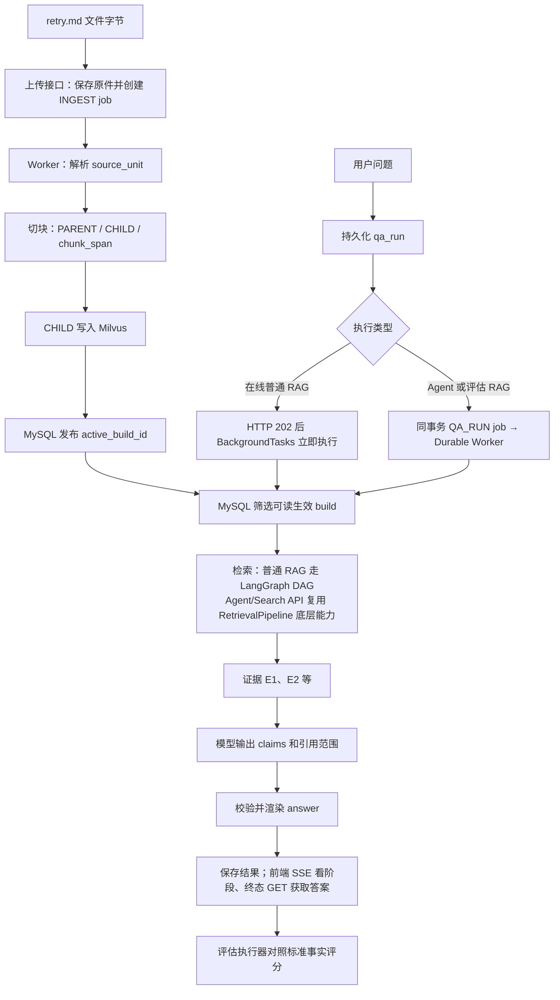

# RAG 项目源码导读：从上传文件到回答与评估

这份文档带你沿着真实数据流阅读当前 Python 实现。目标是读完后能解释：请求从哪里进入、主要函数按什么顺序调用、关键数据怎样变化、结果存在哪里，以及失败时应该检查哪一层。

核对基线：2026-10-09，本导读同步 PR #13 的普通 RAG LangGraph 检索图改造；**PR 合并前，`main` 尚无此检索图**。本文解释所在分支的源码行为；示例代码省略无关分支，不能直接当作可运行函数。教学数据用简短 ID 代替运行时 UUID，不代表真实实验结果。

**阅读规则：当前行为以 `backend/app` 源码为准。** `docs/design` 是早期设计，其中仍含 Java、Spring、Elasticsearch 和尚未完全落地的能力，不应直接用来推断当前 Python 执行过程。

阅读导航：[项目地图](#1-先认识项目再确定阅读顺序) → [贯穿示例](#2-用一个例子贯穿所有流程) → [启动与任务](#3-启动与入口请求和后台任务如何衔接) → [文档入库](#4-文档入库文件如何变成可以检索的内容) → [检索](#5-检索问题如何找到当前用户可用的证据) → [普通 RAG](#6-普通-rag证据如何变成用户看到的答案) → [Agent 与评估](#7-agent-与评估在普通-rag-主线上的扩展) → [失败排查](#8-第二遍阅读追踪权限状态和失败) → [测试跟读](#9-跑测试读源码一个可操作的学习路线)。

## 1. 先认识项目，再确定阅读顺序

这个项目是企业内部知识问答系统：先把文件转换为可检索内容，再在当前用户可读范围内检索，把证据交给模型，最后校验并展示带引用的答案。Agent 模式允许模型决定后续检索动作，评估模块则批量执行并检查这些流程。

| 组件 | 在本项目中的工作 | 源码入口 |
| --- | --- | --- |
| Vue 前端 | 上传、提问、SSE 阶段进度与轮询兜底、查看引用 | [Chat.vue](../frontend/src/Chat.vue)、[Documents.vue](../frontend/src/Documents.vue) |
| FastAPI | HTTP 路由、认证依赖、CSRF、错误响应 | [main.py](../backend/app/main.py) |
| MySQL | 用户权限、文档版本、生效构建、任务和运行记录 | [models.py](../backend/app/models.py)、[db.py](../backend/app/db.py) |
| Worker | 从 MySQL 领取 INGEST/PURGE/EVALUATE/Agent/评估 RAG 等持久任务；在线普通 RAG 不经 Worker | [worker.py](../backend/app/runtime/worker.py) |
| Docling | 所有支持格式统一解析并由 HybridChunker 生成语义块 | [parser.py](../backend/app/knowledge/parser.py) |
| Milvus | 保存子块索引，完成 Dense/BM25/Hybrid 检索 | [milvus_service.py](../backend/app/retrieval/milvus_service.py) |
| LiteLLM | 对接模型服务，提供 Chat、Embedding、Reranker 等别名 | [model_gateway.py](../backend/app/qa/model_gateway.py)、[embedding.py](../backend/app/retrieval/embedding.py) |
| LangGraph | 普通 RAG 的无 Checkpointer 检索 DAG；Agent 的 model/tools 循环和 Checkpointer 恢复是另一张图 | [rag_graph.py](../backend/app/retrieval/rag_graph.py)、[agent.py](../backend/app/qa/agent.py) |

第一遍按第 2～7 节看成功主线。第二遍看第 8 节的权限、租约和失败分支。第三遍运行第 9 节的测试，观察变量。不要一开始从 `models.py` 第一行一路读到底；先遇到哪个对象，就回头找它对应的表。

## 2. 用一个例子贯穿所有流程

假设上传 UTF-8 文件 `retry.md`：

```markdown
# 订单重试规则

订单重试前必须检查幂等键。

重试前应确认尚未达到重试次数上限。

重试前需核对补偿日志，避免重复补偿。
```

用户提问：“订单重试前需要检查哪些事项？”

整个过程可以概括为：



先记住这些对象的区别：

| 对象 | 含义 | 为什么单独存在 |
| --- | --- | --- |
| `document` | 逻辑文档 | 文件更新后仍属于同一份资料 |
| `document_version` | 某次上传的版本 | 保留原件和版本身份 |
| `index_build` | 某次解析与索引构建 | 新构建完成后才切换生效指针 |
| `source_unit` | 标题、段落、表格、代码等原文单元 | 保存来源位置 |
| `chunk` | 为检索或上下文准备的文本块 | 组织不同粒度内容 |
| `chunk_span` | 子块与原文单元及偏移的关系 | 让检索结果可以追溯到原文 |
| `hit` | 某次查询返回的候选记录 | 有分数、build、chunk 等信息 |
| `evidence` | 某次问答登记的证据 | 分配运行内编号，例如 E1 |
| `claim` | 模型给出的一条事实断言 | 必须关联本次 evidence |
| `answer` | 程序根据 claims 渲染的展示文本 | 保持正文和引用的对应关系 |

例如 `E1` 不是全局文档 ID，而是本次问答的证据编号。另一轮问答的 E1 可以指向完全不同的资料。

## 3. 启动与入口：请求和后台任务如何衔接

### 3.1 从哪里开始读

打开 [main.py](../backend/app/main.py)，先定位 `lifespan()`，再看 `csrf_middleware()` 和 `app.include_router(...)`。

```python
app.include_router(knowledge_router, prefix="/api/v1")
app.include_router(retrieval_router, prefix="/api/v1")
app.include_router(qa_router, prefix="/api/v1")
app.include_router(config_router, prefix="/api/v1")
app.include_router(eval_router, prefix="/api/v1")
```

路由文件里的路径还要加 `/api/v1`。例如 `qa/router.py` 中的 `/conversations`，最终是 `/api/v1/conversations`。

`lifespan()` 检查数据库，初始化种子数据并处理未完成任务恢复；非测试环境且启用内嵌 Worker 时，启动三组工作线程：

- `qa` 领取 Agent 和评估 RAG 的 `QA_RUN`，不领取在线普通 RAG。
- `ingest` 领取 `INGEST / PURGE`。
- `eval` 领取 `EVALUATE`。

Worker 也有独立入口。学习时先理解“数据库里的 job 被谁领取”，再研究部署在哪个进程。

### 3.2 HTTP 层负责什么

阅读 [api.ts](../frontend/src/api.ts) 的 `api()`：请求地址加 `/api/v1`，携带会话 Cookie，写请求处理 CSRF，普通对象转换为 JSON，上传使用 FormData。

后端 [identity/deps.py](../backend/app/identity/deps.py) 的 `get_current_actor()` 从 `RAG_SESSION` 查会话、用户和租户，构造：

```python
@dataclass(frozen=True)
class Actor:
    tenant_id: str
    user_id: str
    admin: bool
    security_epoch: int = 0
```

`Actor` 是后续权限判断的身份上下文。不能从客户端 JSON 里的用户 ID 推断当前身份。`require_admin()` 检查维护资格，文档阅读权限则由另一组函数判断。

### 3.3 为什么请求返回了，任务还没完成

不同任务采用不同执行通道：文档入库、评估主任务、Agent 和评估 RAG 写入 MySQL Job，由 Worker 执行；**在线普通 RAG 只写入 `qa_run`，HTTP 202 响应发送后由 FastAPI `BackgroundTasks` 立即启动**，不排队等待 Job Worker。HTTP 202 只表示请求已接收，均不意味着答案生成完成。

在 [worker.py](../backend/app/runtime/worker.py) 按下面顺序读：

```text
run_forever()
  → run_once()
      → _claim_one()                 领取可执行或租约过期的任务
      → _heartbeat_loop()           执行期间续租
      → 按 kind 分派给 _run_*()
      → _requeue_failed_if_retryable()
```

`_claim_one()` 使用行锁与 `skip_locked=True`，领取时增加 `lease_epoch`。这表示“当前第几代执行者”。旧 Worker 即使恢复运行，也不应覆盖新 Worker 的结果，后面的发布与终态写入会检查租约。

**测试环境不同：** 入库、问答、评估的一些入口会直接同步执行。因此测试里 POST 完就能读到结果，不能据此推断生产请求也在 HTTP 线程里完成全部工作。

## 4. 文档入库：文件如何变成可以检索的内容

### 4.1 完整调用链

```text
Documents.vue::upload()
  → POST /api/v1/admin/documents
  → knowledge/router.py::upload_document()
  → KnowledgeService.upload_document()
      → 保存原件和版本、构建记录
      → 写 job(kind=INGEST, status=QUEUED)
  → DurableJobWorker._run_ingest()
      → read_artifact(storageKey)
      → KnowledgeService._execute_ingestion_job()
          → parse_and_chunk_document()
          → Docling /v1/chunk/hybrid/file
          → adapt_docling_hybrid_chunks()
          → source_unit / PARENT / CHILD / chunk_span 入库
          → MilvusHybridService.upsert_chunks()
          → index_build READY + document.active_build_id 切换
```

阅读入口：[knowledge/router.py](../backend/app/knowledge/router.py)、[knowledge/service.py](../backend/app/knowledge/service.py)、[artifacts.py](../backend/app/knowledge/artifacts.py)。

`upload_document()` 接收文件字节、知识库 ID、幂等键和构建配置，完成权限及请求检查，并保存原始文件和数据库记录。返回 `documentId / versionId / buildId / jobId` 后，客户端可通过任务接口查看进度。

**这四个 ID 不要混用。** 查文件生命周期看 document；查上传原件看 version；查解析和索引内容看 build；查执行进度看 job。

### 4.2 统一解析与切块：字节 → Docling Hybrid Chunks

打开 [parser.py](../backend/app/knowledge/parser.py) 的 `parse_and_chunk_document()`。当前所有支持格式都进入同一条路径：

```text
file_bytes
  → Docling Serve /v1/chunk/hybrid/file
  → Docling Parser
  → HybridChunker
  → chunks JSON
  → adapt_docling_hybrid_chunks()
```

Markdown、TXT、PDF、DOCX、Office 等不再分成“本地文本解析”和“二进制 Docling 解析”两条链路。请求会根据配置传入 OCR、表格结构、heading hierarchy、tokenizer、max_tokens 与 merge_peers 等参数。

默认 Child 上限来自 `DOCLING_CHUNK_MAX_TOKENS=400`，默认 Parent 上限来自 `DOCLING_PARENT_MAX_TOKENS=1200`。这里单位是 token，不是字符；Child 的实际分割由 Docling HybridChunker 负责。

### 4.3 适配：Hybrid Chunks → source_unit / PARENT / CHILD / span

打开 [chunker.py](../backend/app/knowledge/chunker.py) 的 `adapt_docling_hybrid_chunks()`。这个函数不再重新切 Child，而是把 Docling 已经生成的 Hybrid Chunk 适配到本项目的数据模型。

核心规则：

- 每个 Docling Hybrid Chunk 对应一个 CHILD。
- 相邻、heading path 相同的 Child 会按 `parent_max_tokens` 组织成 PARENT。
- 同一组 Child 会生成对应 SourceUnit。
- `location` 保留 Docling 的 headings、captions、docItems、pageNumbers 和 metadata。
- `chunk_span` 记录 CHILD 在 SourceUnit 中的偏移和原始 location，供 evidence provenance 使用。

示意数据：

```json
{
  "kind": "CHILD",
  "parent_id": "parent-1",
  "text_content": "订单重试前必须检查幂等键。",
  "token_count": 12
}
```

PARENT 主要用于检索后的上下文扩展；CHILD 才是索引和高精度召回单元。

### 4.4 建索引与发布：有向量不等于已生效

在 `_execute_ingestion_job()` 看这一段：

```python
child_chunks = [c for c in chunks if c.get("kind") == "CHILD"]
```

只有 CHILD 传给 `MilvusHybridService.upsert_chunks()`。入库还按构建配置为 Child 生成 ORIGINAL，以及可选 SUMMARY / QUESTION 表示；这些表示分别入索引，但都关联原始 Child，生成证据前还原原文。PARENT 留在关系数据里，检索后可扩展为上下文。

在 [milvus_service.py](../backend/app/retrieval/milvus_service.py) 看 `upsert_chunks()`，继续追到 [embedding.py](../backend/app/retrieval/embedding.py) 的 `get_embeddings()`。文档文本转换为 dense 向量，真实 Milvus 集合还通过 BM25 function 生成 sparse 表示。索引携带租户、文档、版本、build、chunk 和索引代次等字段，便于过滤和溯源。

最后回到入库执行器的发布事务：将 `index_build.status` 更新为 `READY`，将 `document.active_build_id` 指向该 build，并完成任务。

```text
旧 active_build_id → 仍是当前可检索版本
新 build 正在解析/切块/写索引 → 尚未成为当前版本
发布事务成功 → active_build_id 指向新 build
```

这也是“Milvus 不是版本权威”的含义：数据库生效指针决定哪些索引记录可以参与当前检索。

**对应测试：** [test_ingestion.py](../backend/tests/test_ingestion.py) 中 `test_document_upload_and_preview()`。重点看上传响应、任务状态、preview 中的 units/chunks，以及新版本上传后的变化。

## 5. 检索：问题如何找到当前用户可用的证据

### 5.1 先读短函数，再读底层实现

**先区分入口**：普通问答及 RAG 评估（`mode=RAG`）进入 [rag_graph.py](../backend/app/retrieval/rag_graph.py) 的 `RagRetrievalGraph.retrieve()`，由 LangGraph 编排检索；Agent 的 `search_knowledge`、独立 Search API 和纯检索评估仍调用 [pipeline.py](../backend/app/retrieval/pipeline.py) 的 `RetrievalPipeline.retrieve()`。这些入口复用同一套 Milvus、RRF、Reranker、MMR、Parent、权限与来源工具。

普通 RAG 检索图的实际节点顺序如下（Dense / BM25 并行完成，再汇入 RRF）：

```text
QaService._execute_run(mode=RAG)
  → RagRetrievalGraph.retrieve()
  → resolve_scope：config + evaluation_scope + ACL + active_build_id
       ├─ 无可读 build → no_scope → END (hits=[])
       └─ 有可读 build → prepare_query (Rewrite / Multi-Query / HyDE)
                           ├─ dense_recall  (可按配置禁用)
                           └─ bm25_recall   (可按配置禁用)
                         → rrf_fusion (汇合两路)
                         → hydrate_and_acl
                         → rerank → mmr → parent_expansion
                         → context_budget → finalize_hits
                         → END (hits / warnings / config / allowedBuildCount)
```

Agent / Search API / RETRIEVAL_* 评估继续使用原单体检索函数，函数内部的步骤为：

```text
RetrievalPipeline.retrieve(actor, query, kb_ids, document_ids, config_id, run_id, history)
  → load_retrieval_config()
  → 应用 run_document_scope()（评测运行）
  → get_readable_build_records()
  → _prepare_queries()：按配置 Rewrite / Multi-Query / HyDE
  → 各查询变体分别调用 MilvusHybridService.search() 做 BM25 / Dense 召回
  → 多路结果通过 rrf_fuse() 融合
  → _hydrate_original_chunks()：多表示命中还原为原始 Child 文本
  → assert_hits_still_readable()
  → 可选 rerank_hits()
  → 可选 _mmr_select()
  → 可选 _expand_parents()
  → 按 context_max_bytes 与 final_top_k 限制上下文
  → _attach_provenance()
  → 按 final_top_k 截取
  → 再次 assert_hits_still_readable()
  → 返回 hits / warnings / config / allowedBuildCount
```

**图的执行边界**：本次只编排检索阶段，生成答案、Claims/Judge 验证与最终 `qa_run` 提交依旧在 `QaService`。普通 RAG 图不启用 Checkpointer；在线请求仍在 FastAPI `BackgroundTasks` 中执行，进程异常时不会自动从 `rrf_fusion` 或 `rerank` 节点继续。RAG 评估仍走现有 `QA_RUN` Worker，但暂未获得检索图的节点级恢复能力。详见 [普通 RAG LangGraph 检索图说明](rag-langgraph-retrieval.md)。

### 5.2 权限过滤先于检索

```python
with get_db_connection() as conn:
    readable = get_readable_build_records(conn, actor, kb_ids, document_ids)

allowed_build_ids = [row["buildId"] for row in readable]
```

在 [identity/deps.py](../backend/app/identity/deps.py) 定位 `get_readable_build_records()`：检查租户、用户有效性、知识库授权、文档 ACL、文档 LIVE、当前 build READY，再应用可选知识库/文档范围。

没有可读 build 就直接返回空结果。管理员维护资格也不会在这段逻辑里自动绕过正文授权。

允许列表和 `indexEpoch` 传入 Milvus。检索后再次检查，是为了应对“检索期间撤权或切换了版本”；尤其不能在将候选发送给外部 Reranker 后才第一次检查权限。

### 5.3 BM25、Dense 和 Hybrid 在哪里分支

无论普通 RAG 的 LangGraph 检索图，还是 Agent / Search API 的 `RetrievalPipeline.retrieve()`，都根据当前有效配置选择 BM25 / Dense 路线，调用 `MilvusHybridService.search()`；底层 `search()` 也支持直接 HYBRID 调用：

| 模式 | 核心操作 | 阅读时关注 |
| --- | --- | --- |
| BM25 | 搜索 sparse 字段 | 查询词与文档词项匹配 |
| DENSE | 问题 embedding → dense 向量搜索 | 查询与索引维度一致 |
| HYBRID | 两路检索，通过 RRF 融合 | 两路候选数量和融合排名 |

普通 RAG 图通过并行 `dense_recall` / `bm25_recall` 节点取回排名列表，在 `rrf_fusion` 节点调用 `rrf_fuse()`；`RetrievalPipeline.retrieve()` 也沿用相同的应用层加权融合逻辑。底层 `MilvusHybridService.search(mode="HYBRID")` 也分别调用 `client.search()`，将 ORIGINAL / SUMMARY / QUESTION 等表示归一并按 canonical chunk 去重后再做 RRF；不再直接使用 Milvus `hybrid_search(..., ranker=RRFRanker(...))`，避免同一子块的不同表示重复投票。RRF 综合各路线里的名次，不直接混加两种不可比的原始分数。

测试环境另有内存检索和确定性 embedding 路径。它们适合验证过滤和执行逻辑，不能代表真实向量的语义质量，也不能用其表现估计生产 Milvus 性能。

### 5.4 重排、父块扩展与来源映射

`rerank_hits()` 使用问题和候选文本重新排序；是否启用、保留多少条、失败是否允许降级，由有效配置决定。阅读 [config.py](../backend/app/retrieval/config.py) 的 `RetrievalConfig.from_payload()`，不要只看配置 JSON 的名字就认为某个开关已被执行。

`_expand_parents()` 找到命中 CHILD 对应的 PARENT，将未超过 `parent_max_chars` 的父文本放进 `hit.text`，原命中文本留在 `matchedText`，并增加 `parentChunkId`，同父块去重。父文本过长时保留 Child，不截断父文本，并记录 `PARENT_TRIMMED` / `parentTruncated=true`。扩展后还按 `context_max_bytes` 限制 UTF-8 字节总量；若最佳父块独自超限，尝试退回原始 Child，不能满足预算则不保留该项。

因此：

```text
chunkId        = 用来定位检索命中的子块
parentChunkId  = 实际扩展使用的父块（如果启用）
matchedText    = 子块命中文本（发生父扩展时）
text           = 后续用于上下文的文本
```

`_attach_provenance()` 通过 `chunk_span → source_unit` 补充来源。能在当前上下文找到完整单元时，设置 `contextMapped=true` 并保存上下文偏移；找不到时仍保留来源信息，不能把 `contextMapped=false` 解释为已有精确上下文映射。

两条检索编排入口均接入 Rewrite、HyDE、Multi-Query 和 MMR，但都由配置开关控制。Rewrite 还要求存在历史，并保留原问题与改写问题；Multi-Query 增加等价问法；HyDE 只贡献 Dense 路线，不把假想文本作为事实证据；MMR 在重排后、父块扩展前选择候选。开启策略不等于已证明效果更好，仍需固定其他条件做实验。

**对应测试：** [test_qa.py](../backend/tests/test_qa.py) 的 `test_qa_run_lifecycle_and_evidence()` 校验普通 RAG 检索图各阶段事件与实时执行契约；[test_enterprise_retrieval.py](../backend/tests/test_enterprise_retrieval.py) 的 `test_config_driven_rerank_parent_expansion_and_provenance()`、[test_retrieval.py](../backend/tests/test_retrieval.py) 的 `test_hybrid_search_acl_and_rebuild()` 校验仍被 Agent / Search API 等入口复用的原检索组件。

## 6. 普通 RAG：证据如何变成用户看到的答案

### 6.1 前端提交与后端接收

从 [Chat.vue](../frontend/src/Chat.vue) 的 `submit()` 和 `watchRun()` 开始：前端拿到 run ID 后，使用 `EventSource` 订阅 GET `/runs/{id}/events`，收到阶段事件更新进度；`done` 后调用 GET `/runs/{id}` 获取最终答案，SSE 不可用或出错时退回 `poll()`。**这只是阶段 SSE，不是模型逐 Token 流式生成**；完整的结构化 JSON 必须先经引用和可选 strict Judge 校验。

```text
Chat.vue::submit()
  → POST /api/v1/conversations/{id}/runs
  → qa/router.py::submit_run()
  → QaService.submit_run()
      → 输入检查、会话归属、上下文分段、幂等与并发检查
      → 写 qa_run(QUEUED)，在线 RAG 不写 job
      → 返回 HTTP 202 / runId / executionMode=REALTIME
  → FastAPI BackgroundTasks(QaService.execute_queued_run)
  → QaService._execute_run()
      → RagRetrievalGraph.retrieve()：检索阶段 LangGraph DAG
      → Evidence 固化 → ModelGateway 生成 → Claims/Judge 校验
      → 写 run_event 阶段事件，最终保存已验证答案
  → 前端 EventSource /runs/{id}/events → done 后 GET /runs/{id}

Agent / 评估 RAG：submit_run 同事务写 qa_run + job(QA_RUN)
  → DurableJobWorker._run_qa()
  → QaService.execute_queued_run(job_id, lease_epoch) → _execute_run()
```

主要文件：[qa/router.py](../backend/app/qa/router.py)、[qa/service.py](../backend/app/qa/service.py)、[rag_graph.py](../backend/app/retrieval/rag_graph.py)。在长文件中先按函数名搜索，不要从所有会话管理接口开始逐行阅读。

`conversation` 表示会话，`context_segment` 是会话范围上下文，`qa_run` 始终记录一次问题执行；**只有 Agent、评估 RAG 会同时拥有驱动执行的 `QA_RUN` Job**。在线普通 RAG 的 `qa_run` 没有对应 Job。两种通道复用同一问答核心和最终验证。

### 6.2 `_execute_run()` 的九步主线

| 顺序 | 代码位置或调用 | 本例发生什么 |
| --- | --- | --- |
| 1 | `classify_question()` | 本例归为知识问答 |
| 2 | 读取 segment 范围 | 确定知识库范围 |
| 3 | `RagRetrievalGraph.retrieve()` | 通过 Scope、Dense/BM25、RRF、重排、Parent、上下文预算取得 hit |
| 4 | 创建 evidence / evidence_map | 为正文分配 E1 等编号 |
| 5 | 写 `run_source` | 记录本次运行依赖的文档与来源 |
| 6 | `ModelGateway.chat()` | 将问题与 evidence 交给 chat-main |
| 7 | `validate_claims()` | 核对结构、引用编号和区间 |
| 8 | `_verify_answer()` 与 `validate_output()` | 统一严格验证、输出规则检查 |
| 9 | `_finalize_run()` | 保存结果及任务终态 |

问题路由见 [question_router.py](../backend/app/qa/question_router.py)：当前是正则规则。问候语和少数不支持请求返回固定文本，不需要检索和模型；其余默认进入知识问答。

如果检索无命中，直接构造 `NO_EVIDENCE` 业务结果：“当前可访问资料不足以回答。”这不是模型凭记忆尝试回答。

### 6.3 hit → evidence：哪些材料真正交给模型

核心节选：

```python
eid = f"E{idx}"
evidence.append(ev_item)
evidence_map[eid] = h["text"]
```

`ev_item` 保存 evidenceId、文档/版本/build/chunk、位置、文本和分数；`evidence_map` 是编号到文本的映射，供后续引用校验。

随后构造模型输入：

```python
messages = [
    {"role": "system", "content": INSTRUCTION},
    *history,
    {"role": "user", "content": json.dumps({"question": question, "evidence": evidence}, ensure_ascii=False)},
]
```

本例的 user 内容是“问题 + 本次证据”，生成 messages 还包含 `_rag_history()` 取得的授权历史。历史只取当前 segment 中最多四条较早的成功运行，并受问题与答案合计 4000 字符限制，不是整个会话。历史来源会重新检查权限；评测运行还检查快照范围和生效 Build，并登记依赖供模型外发前复核。相同 `history` 也传给检索流水线，配置允许时用于 Rewrite。

实际材料大小受检索条数、父块长度、`context_max_bytes` 和历史字符预算等限制。检索上下文使用 UTF-8 字节预算，不是设计文档中的完整 token 级装箱流程；Agent 的消息裁剪则另有 token 预算。

### 6.4 模型输出 → claims → answer

打开 [claim_validator.py](../backend/app/qa/claim_validator.py)，先看 `INSTRUCTION`，再读 `validate_claims()`。模型被要求输出结构化对象，而不是自行提供 `answer` 自由文本。

为了直观看引用区间，假设某次证据 `E1` 只有“检查幂等键”五个字，一个合法形状的教学输出是：

```json
{
  "status": "COMPLETED",
  "claims": [{
    "id": "C1",
    "text": "重试前需要检查幂等键。",
    "evidence": [{"evidenceId": "E1", "start": 0, "end": 5}]
  }],
  "gaps": [],
  "conflicts": []
}
```

区间为 Unicode code point 半开区间 `[start, end)`，在 Python 中对应 `text[start:end]`。真实本例若 evidence 是完整父块，偏移必须按那个实际文本计算，不能复用上述 0..5。

`validate_claims()` 检查允许字段、状态、claims 数量、claim ID、引用编号、引用格式和冲突对，并渲染：

```python
rendered_claims.append(f"{text} [{', '.join(ev_labels)}]")
```

最终用户看到的文本类似“重试前需要检查幂等键。 [E1]”。真实问题要求三项事实，仅给出这一项不代表内容完整，即使结构校验通过。

**注意当前代码的实际行为：** 引用编号不存在、证据正文为空、区间非整数、负起点、倒置或超出正文长度，都会以 `INVALID_MODEL_EVIDENCE` 拒绝；不再把错误区间扩成整条 evidence。结构通过只表示格式与来源约束通过，不证明证据在语义上支持断言。

### 6.5 模型网关做什么

顺着 `ModelGateway.chat()` 到 [model_clients.py](../backend/app/qa/model_clients.py) 的 `get_chat_model()`，可以看到 LangChain 消息适配与模型客户端。网关使用内部别名调用 LiteLLM，记录 `model_call`，并使用运行策略进行有限重试。

如果没有真实网关配置，测试环境可以走可控替身；非测试环境会返回网关不可用，不能把单元测试的生成文本当成真实模型效果。Embedding 仍有独立的 `get_embeddings()` HTTP 路径，但当前每个批次也执行预算预留、运行/任务检查及 `model_call` 记录；缺少实际 usage 时标记 `UNKNOWN`。记录调用不等于已经完成供应商账单对账或验证绝对硬预算。

### 6.6 保存状态与读取结果不是同一件事

`_finalize_run()` 保存数据库运行状态和 `result_json`。成功执行的数据库状态可为 `SUCCEEDED`，而 `result_json.status` 可为 `COMPLETED / PARTIAL / NO_EVIDENCE / CONFLICT` 等业务状态。

在 `get_run()` 中：

```python
if r.result_json:
    base.update(r.result_json)
```

因此对外响应中的 `status` 可能被业务结果覆盖。调试时应一起查看数据库运行状态、`terminalReason` 和响应内容，不能把所有 `status` 当成同一层枚举。

`get_run()` 还检查来源当前是否可读，不可读则返回 `visibility=HIDDEN`；对旧 build 的 evidence 增加 `isCurrent`。历史答案不会因为过去生成过就永远可展示。

**对应测试：** [test_qa.py](../backend/tests/test_qa.py) 的 `test_qa_run_lifecycle_and_evidence()`、`test_qa_no_evidence_handling()`、`test_claim_validator_logic()`。

## 7. Agent 与评估：在普通 RAG 主线上的扩展

### 7.1 Agent 增加了什么决策

普通 RAG 由程序按配置执行检索流水线再生成，其中可包含多个查询变体和召回路线；Agent 让模型根据已有信息选择工具、检索内容和停止时机。它不是把普通 RAG 固定重复若干次。

在 `_execute_run()` 的 `mode == "AGENT"` 分支进入 [agent.py](../backend/app/qa/agent.py) 的 `LangGraphAgent.run()`。按这个顺序阅读：

```text
run()：准备输入、历史、策略、截止时间和 checkpoint/resume
  → _get_graph()：定义图
  → _model_step()：模型决定下一步
      ├─ 无 tool_calls → 解析最终 JSON → validate_claims → 结束
      └─ 有 tool_calls → _tools_step()
                           → 执行工具、累积证据、追加 tool 消息
                           → 返回 _model_step()
```

图的实际定义节选：

```python
builder.add_node("model", cls._model_step)
builder.add_node("tools", cls._tools_step)
builder.add_edge(START, "model")
builder.add_conditional_edges(
    "model",
    cls._route_after_model,
    {"tools": "tools", END: END},
)
builder.add_edge("tools", "model")
```

`AgentState` 保存 messages、round、tool_calls_count、repeated_calls、evidence、evidence_map、warnings 和 final_answer。`AgentContext` 保存身份、run ID、配置、截止时间和回调。前者是循环中的变化状态，后者提供运行依赖。

### 7.2 两个工具与本例轨迹

| 工具 | 实现路径 | 作用 |
| --- | --- | --- |
| `search_knowledge` | `_tools_step()` → `RetrievalPipeline.retrieve()` | 在授权范围检索并登记证据 |
| `read_section` | `_tools_step()` → `_read_section()` | 读取指定文档/build/source unit 的内容 |

教学轨迹可能是：

```text
用户：订单重试前需要检查什么？
模型：调用 search_knowledge(query="订单重试 检查事项")
程序：返回证据摘要与 E1 编号，追加 role=tool 消息
模型：若证据已足够，输出三条 claims；否则继续搜索或 read_section
程序：validate_claims 后返回 answer
```

`tool_calls` 是模型提出的请求；工具真正执行、查权限、记录来源和限制预算由 Python 程序完成。模型不能因为输出一个工具名就直接绕过权限。

搜索结果会去重，证据保存在状态中。工具消息发送压缩摘录，而完整原文仍可保存在 `evidence_map`；二者可能长度不同，不能把“系统存了完整证据”自动等同于“模型完整读过该证据”。

### 7.3 为什么循环不会无限运行

阅读 [runtime.py](../backend/app/qa/runtime.py) 的 `AgentRuntimePolicy`、`assert_runtime_budget()`、`compact_messages()`、`retry_call()`。

当前有截止时间、主循环次数、工具调用数、重复调用、模型调用和 token 使用等约束。超过限制会产生明确错误；上下文压缩尽量保留当前问题及工具消息配对。

需要审批的工具通过 LangGraph `interrupt()` 暂停；`JobCheckpointSaver` 将图状态持久化到任务相关存储。审批接口进入 `QaService.resolve_tool_approval()`，随后 `queue_resume()` 安排恢复。理解普通 model/tools 循环后，再读 [job_checkpointer.py](../backend/app/qa/job_checkpointer.py)，不必第一遍就深入 checkpoint 序列化。

### 7.4 普通 RAG 与 Agent 共用严格验证

普通 RAG 在 `validate_claims()` 后、Agent 在 `LangGraphAgent.run()` 返回后，都由 [service.py](../backend/app/qa/service.py) 的 `_verify_answer()` 执行同一验证合同。默认标记 `verification=STRUCTURAL_ONLY`；只有 strict 开启且存在 claims，才额外调用 `judge-main` 做逐 Claim 支持性判定。无 claims 时不会调用严格裁判，也不会因此标为 `SUPPORTED`。

`_validate_strict_verdicts()` 要求返回 verdicts 列表完整覆盖全部 claim ID、每个 ID 恰好一次且状态全部为 `SUPPORTED`。存在 claims 时，空列表、漏判、重复 ID、未知 ID、`UNSUPPORTED` 或 `UNCERTAIN` 都会以 `VERIFICATION_FAILED` 拒绝；校验通过后还会复核来源权限，再标记 `verification=SUPPORTED`。模型裁判可能判断错误，这个标记不是正确性的证明。

在线严格验证检查“每条断言是否被引用资料支持”；离线 [evaluation/judge.py](../backend/app/evaluation/judge.py) 还根据完整答案、金标准事实、问题与历史评估正确性、相关性和题型预期，二者不能混用。回归入口包括 [test_migration_parity.py](../backend/tests/test_migration_parity.py) 的 `test_strict_judge_requires_complete_claim_coverage()`，以及 [审计回归](reviews/2026-09-26-audit/test_audit.py) 的 `test_strict_rag_rejects_empty_judge_verdicts()` / `test_strict_agent_actually_calls_judge()`。

**对应测试：** [test_agent.py](../backend/tests/test_agent.py) 的 `test_agent_single_tool_search_and_answer()`、`test_agent_repeated_calls_termination()`；[test_agent_runtime.py](../backend/tests/test_agent_runtime.py) 的 `test_agent_hitl_checkpoint_and_resume()`。

### 7.5 评估如何复用问答流程

阅读 [evaluation/runner.py](../backend/app/evaluation/runner.py)：

```text
estimate() → start() → 写 EVALUATE job 和全部 PENDING 结果
  → Worker._run_evaluate()
  → EvaluationRunner._execute_run()
      ├─ 检索模式 → RetrievalPipeline.retrieve()
      └─ RAG/AGENT → _run_qa_turns() → 同一会话逐轮 submit_run / get_run
  → _compute_retrieval_metrics()
  → 状态检查 + 可选 judge_answer()
  → 保存单题结果 → aggregate() → export_run()/compare()
```

对本例，金标准应有“幂等键、重试次数上限、补偿日志”三个事实组。只找到一组也可能 Hit@5=1；模型只答出一项不应算完整成功。`judgeMode=HUMAN` 默认保留待复核结果，LLM 模式才进行语义裁判。

指标、API 示例、成功率分母、快照范围、多轮执行与最后一轮评分范围、门禁详见 [RAG 评估完整说明](rag-evaluation-guide.md)。这里优先理解它怎样调用已读过的问答服务，而不是另外实现一套独立 RAG。

## 8. 第二遍阅读：追踪权限、状态和失败

### 8.1 看哪些表，不必先记全部字段

在 [models.py](../backend/app/models.py) 按下面变量名定位表定义：

| 流程 | 优先查看的表变量 | 重点字段 |
| --- | --- | --- |
| 身份 | `app_user_table`、`auth_session_table` | tenant、user、有效状态 |
| 原始资料 | `document_table`、`document_version_table` | 文档状态、版本、active_build_id |
| 解析索引 | `index_build_table`、`source_unit_table`、`chunk_table`、`chunk_span_table` | build、kind、parent_id、来源偏移 |
| 后台执行 | `job_table` | kind、target_id、status、checkpoint、lease_epoch |
| 问答 | `conversation_table`、`context_segment_table`、`qa_run_table` | owner、scope、question、result_json |
| 溯源与调用 | `run_source_table`、`run_event_table`、`model_call_table` | 来源关联、阶段事件、调用用途和用量 |
| 评估 | `eval_run_table`、`eval_result_table`、`eval_review_table` | manifest、单题结果、追加复核 |

`run_event` 是程序组装的阶段记录，`model_call` 是模型调用记录，模型返回 JSON 是另一种数据。不要把它们统称为模型“自己输出的完整执行轨迹”。

### 8.2 三条跨模块约束

**权限不是只在入口检查一次。** 入口认身份，检索前限制 build，外发前检查候选，读取历史时检查来源。这些调用散落在多个文件，但沿同一份证据追踪就能理解各自目的。

**任务重试不等于任意重放。** 入库重试会清理未发布 build 的部分产物并重建；有 Durable Job 的 QA（Agent、评估 RAG）通过 `qa_execution_scope()` 和 `qa_lease_is_current()` 进行 lease fencing，Agent 还能通过 checkpoint 恢复；在线 RAG 没有 Job Lease，进程中断后启动恢复将遗留 run 标为 `FAILED / PROCESS_RESTARTED`，不自动重放。租约过期时旧执行者不能继续发布，但这些机制也不意味着模型外部调用已获得全局 exactly-once 保证。

**业务终态与工程成功分开看。** 无证据是业务结果，网关不可用是执行故障，格式正确是结构检查通过，答案正确则需要语义或人工评价。

### 8.3 遇到现象应该从哪里看

| 现象 | 建议定位顺序 |
| --- | --- |
| 上传返回了但搜不到 | job 状态 → source_unit/chunk → build READY → active_build_id → ACL → 索引 |
| 检索命中但答非所问 | hit.text → evidence → 模型 messages → claims → 金标准事实 |
| 子块命中，引用却显示一大段 | `_expand_parents()`、matchedText、parentChunkId |
| 在线普通 RAG 没有继续执行 | `qa_run.status/stage` → API BackgroundTasks → `run_event` → `PROCESS_RESTARTED` / cancel / 模型服务；不必检查 QA_RUN Job |
| Agent / 评估 RAG 没有继续执行 | `QA_RUN` Job → Worker kinds、任务租约、cancel、WAITING_APPROVAL、runtime 限制 |
| 数据库是 SUCCEEDED，接口是 PARTIAL | `result_json.status` 与 `get_run()` 的合并 |
| 以前能读的答案现在隐藏 | `get_run()` → `_all_sources()` → `can_read_document()` |
| 评估成功率很高但大量题没审核 | judgedCases、judgmentCoverage、最新人工标签 |

## 9. 跑测试读源码：一个可操作的学习路线

### 9.1 先确认测试环境与真实环境的区别

[conftest.py](../backend/tests/conftest.py) 使用内存 SQLite，设置 test 环境并清空真实模型与 Milvus 配置。部分测试还会 monkeypatch 外部调用。这些测试可以观察完整 HTTP 调用和数据库变化，但不等于真实 MySQL、Milvus、Docling 与付费模型的联合验收。

### 9.2 第一组：只看解析和切块

在现有 IDE 的 Python 调试器里给 `parse_and_chunk_document()`、`adapt_docling_hybrid_chunks()` 打断点，运行：

```powershell
# 在仓库根目录打开 Windows 原生 PowerShell；需要已经安装 backend/.venv。
Push-Location -LiteralPath .\backend
try {
    & .\.venv\Scripts\python.exe -m pytest tests/test_ingestion.py::test_document_upload_and_preview -q
    if ($LASTEXITCODE -ne 0) { throw '入库测试失败' }
} finally {
    Pop-Location
}
```

断点要观察：`file_bytes → Docling Hybrid Chunks → units/chunks/spans → child_chunks`。重点看 Docling 返回的 headings/pageNumbers/num_tokens 如何被适配为 SourceUnit、Parent、Child 和 provenance。

### 9.3 第二组：看检索和回答

在 backend 目录运行已有测试：

```powershell
& .\.venv\Scripts\python.exe -m pytest tests/test_enterprise_retrieval.py::test_config_driven_rerank_parent_expansion_and_provenance tests/test_qa.py::test_qa_run_lifecycle_and_evidence -q
if ($LASTEXITCODE -ne 0) { throw '检索与问答测试失败' }
```

普通 RAG 的断点按顺序放在 `RagRetrievalGraph._resolve_scope()`、`_dense_recall()` / `_bm25_recall()`、`_rrf_fusion()`、`_rerank()`、`_context_budget()`，然后追到 `QaService._execute_run()` 中生成前及 `validate_claims()`。观察 `allowed_build_ids`、`dense_routes` / `sparse_routes`、`hits`、`evidence_map` 和最终 `messages`。Agent / Search API 的旧检索路径仍可在 `RetrievalPipeline.retrieve()` 设置断点。

运行 pytest 命令本身不会自动启用 IDE 断点；若用命令行交互调试，可在命令中加 `--trace` 从测试入口进入，或用 IDE 的 pytest 调试配置启动。

### 9.4 第三组：看 Agent 和完整用户流程

仍在 backend 目录执行：

```powershell
& .\.venv\Scripts\python.exe -m pytest tests/test_agent.py::test_agent_single_tool_search_and_answer tests/test_agent_runtime.py::test_agent_hitl_checkpoint_and_resume tests/test_system_e2e.py::test_e2e_full_user_and_admin_workflow -q
if ($LASTEXITCODE -ne 0) { throw 'Agent 与系统流程测试失败' }
```

观察 `_model_step()` 返回的 tool_calls，接着看 `_tools_step()` 如何写入 evidence 并追加 tool 消息；再观察审批暂停与恢复。`test_e2e_full_user_and_admin_workflow()` 可用作学习用的客户端脚本，帮助串起认证、资料和问答接口。

### 9.5 怎样判断自己已经读懂

尝试不看文档回答这些问题，然后回到对应函数验证：

1. 为什么上传成功还要等待 job，但在线普通 RAG 不进入 job？为什么要同时有 version 和 build？
2. 为什么只索引 CHILD，模型却可能看到 PARENT？
3. 文档撤权后，Milvus 里还有向量为什么也不应该被使用？
4. E1 是在哪里产生的？怎样追到 source_unit？
5. 模型输出的 claim 为什么不能直接当成正确事实？
6. `SUCCEEDED` 与答案 `PARTIAL` 为什么能同时出现？
7. Agent 是谁决定调用工具、谁真正执行工具？
8. 单元测试通过能证明什么，不能证明什么？
9. 评估里 100% 成功率为什么仍可能无法通过门禁？

能沿着代码解释这九个问题，说明已经掌握项目主要过程；之后再深入删除传播、租约恢复、模型计费、复杂 ACL 和部署配置。

## 10. 与现有文档如何配合

推荐顺序是：[README 总览](../README.md) → 本源码导读 → [普通 RAG LangGraph 检索图说明](rag-langgraph-retrieval.md) → [评估完整说明](rag-evaluation-guide.md) → 按需查阅旧设计中的设计意图。

本导读区分当前实现和验证范围：同步测试不等于真实依赖验收；普通 RAG 与 Agent 共用严格验证，但模型裁判不保证正确；越界引用被拒绝；高级检索策略按配置执行，其效果仍需实验；评测逐轮执行，但只评分最后一轮。阅读历史设计或报告时，应保留这些边界。

文档核对不代替真实依赖端到端运行。后续修改代码时，应一起检查这里的函数链、数据字段和分支说明是否仍然成立。
